# High-level design

What estate-kit will look like as a system, from the whole picture down to
the classes inside each step, in the order a reader needs them. Each section
links to the page that holds the detail. The decisions behind it are
[record 13](../decisions/0013-every-program-is-rust.md),
[record 18](../decisions/0018-the-service-links-the-compiler.md) and
[record 50](../decisions/0050-five-bounded-contexts.md) and
[records 67 to 71](../decisions/register.md), all accepted.

## 1. The whole system

Five bounded contexts, each a set of crates, and the outside systems each one
talks to. A Project's CI runs the CLI offline and calls the service to deploy;
the service links the compiler; Flux applies what the service publishes; the
components and the host applier act on what the compiler renders.

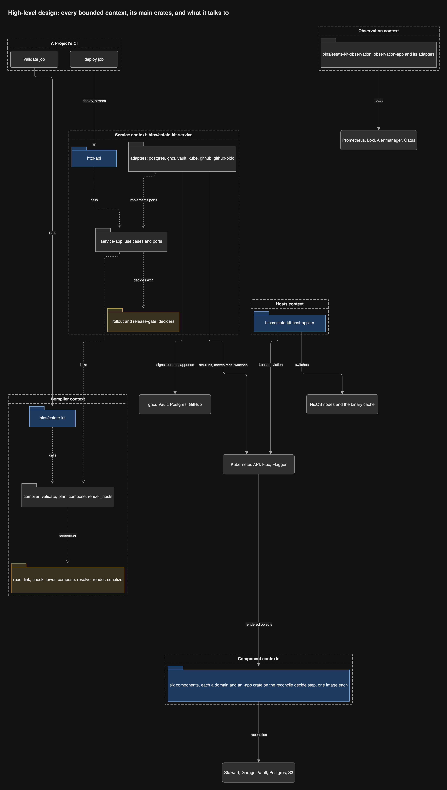

The same system at C4 level 2, with the protocol on each edge:

## 2. The divisions

**By layer.** Every crate is in one layer, and every dependency points down.
`cargo xtask check-layers` refuses any other edge
([record 50](../decisions/0050-five-bounded-contexts.md)).

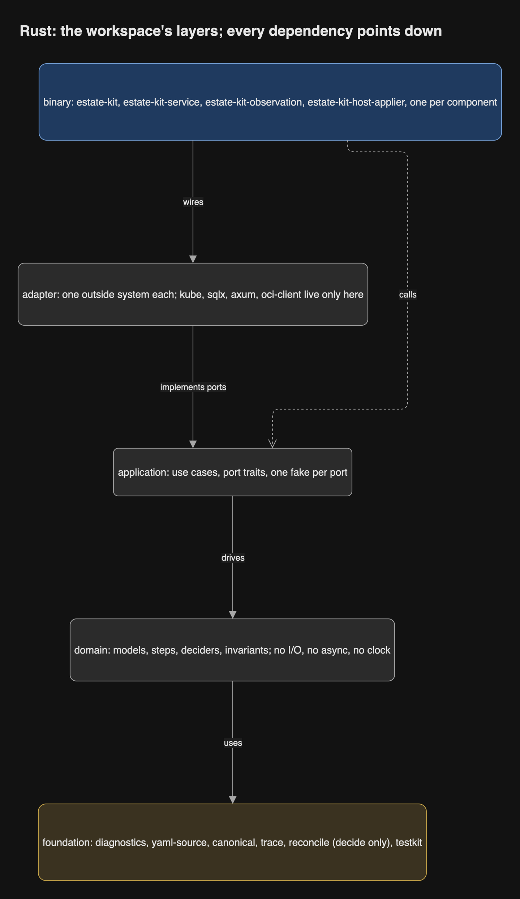

**By context.** How the contexts depend on each other, and what crosses each
boundary:

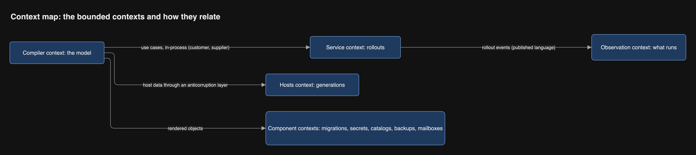

**By crate.** The compiler's crates, where no step crate depends on another:

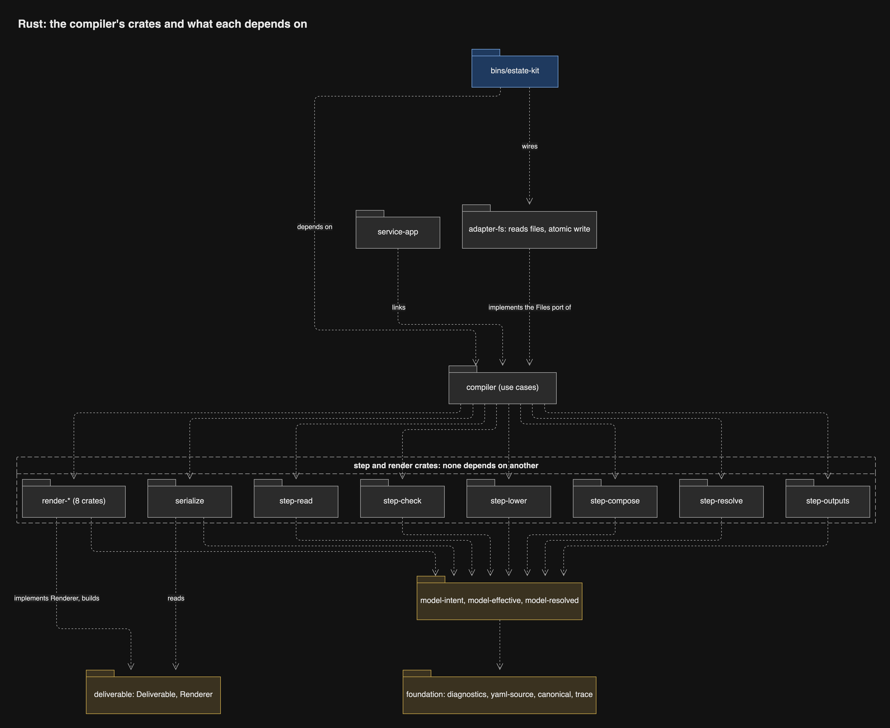

The service's crates, where adapters implement the ports of `service-app`:

Every crate, with one line on what it holds, is in
[The crates](rust-workspace.md#the-crates).

## 3. The pipeline, step by step

Each step turns one typed model into the next and adds to one list of
diagnostics; none stops at the first error.

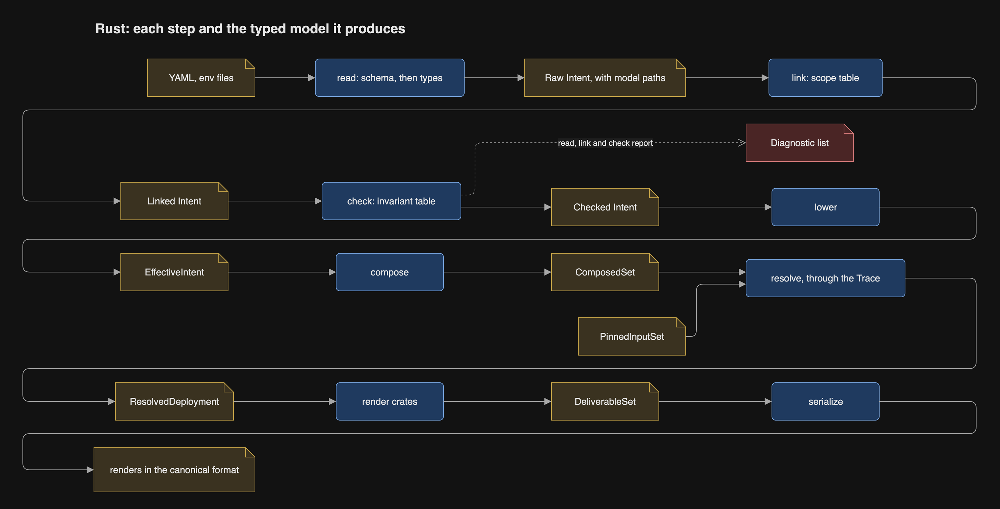

**Read, link and check.** YAML is parsed with a model path on every node,
validated against the committed schema, converted, linked through a scope
table, and checked by the invariant table. Each phase has its own type, and
`Checked` can be built only by `step-check`.

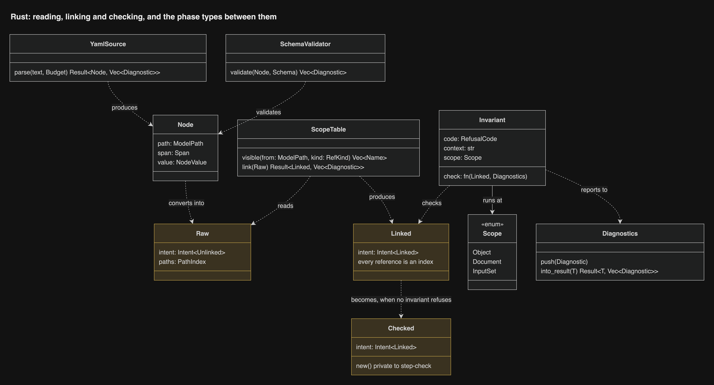

**Resolve.** One function per source-to-target mapping, in two phases through
one `Trace`: phase 1 allocates an id for every element others refer to, phase
2 fills each target and resolves its references. Revisions are a pass over
the finished value.

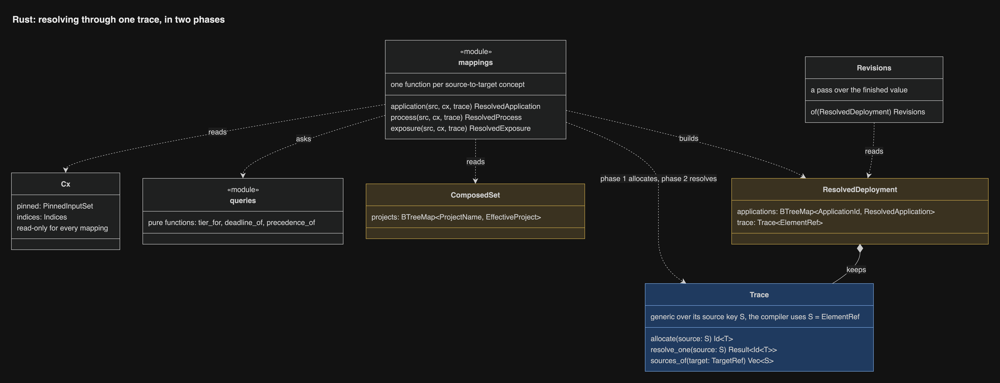

**Render and serialize.** Eight renderers behind one trait build Deliverables
of the narrow object model; one serializer checks ownership and writes the
canonical format.

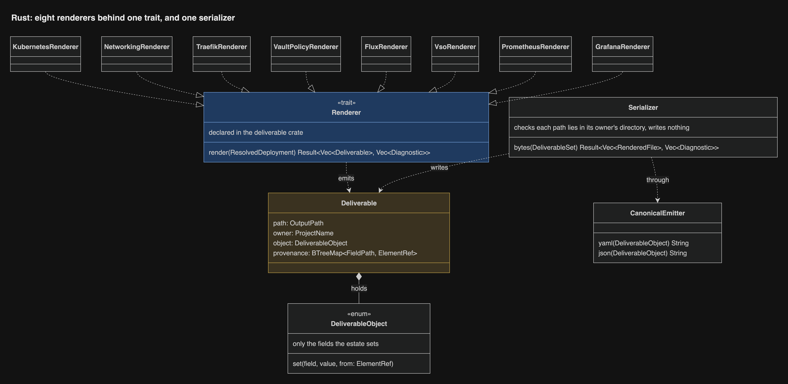

The types that cross the seams between steps:

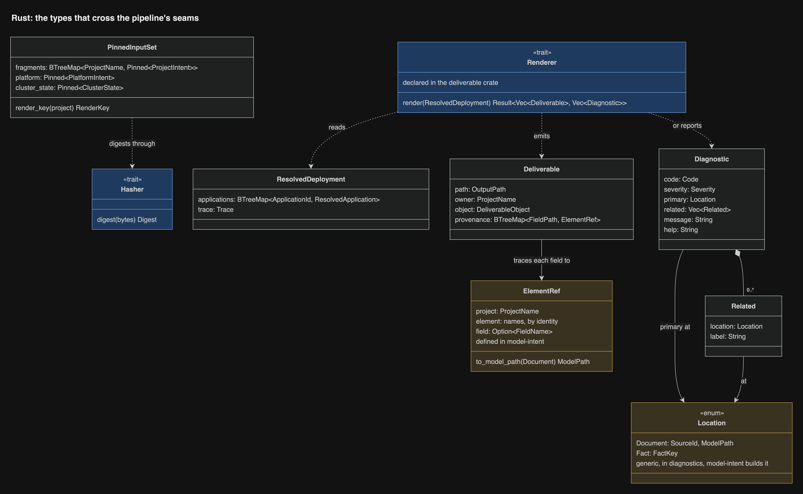

Why each step has this shape, and which MDE lesson it keeps, is
[Transformations without a DSL](transformations.md).

## 4. Control flow: one deploy

One deploy call, through every crate it touches, from the CI job's request to
the moved tag and the streamed events:

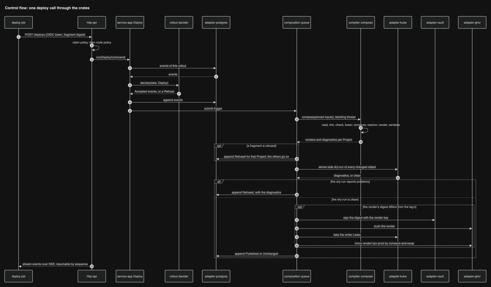

The decisions inside the composition, with every way it can end:

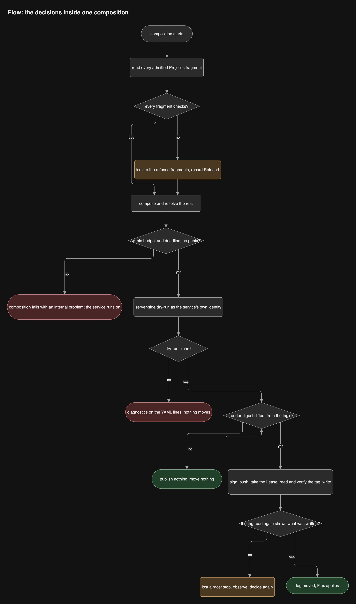

The rollback, host rollout and component paths are traced the same way in
[End to end, crate by crate](end-to-end.md).

## 5. The service's code

The use cases are generic over one bundle of ports, so `main` wires the real
adapters and tests wire the fakes. The queue runs one composition at a time,
through a runner that isolates the compiler.

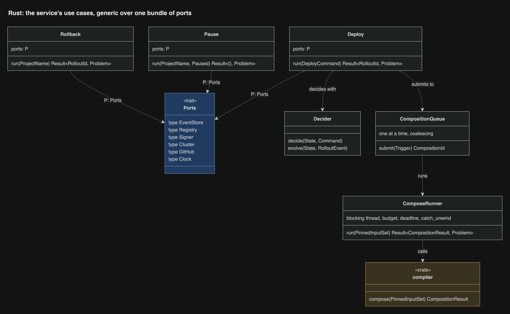

A rollout is a pure decider: `decide` turns a command into events, `evolve`
folds them into state.

## 6. The drivers

The six components and the host applier share one pure decide step in
`reconcile`: what differs between desired and observed. Each context's `-app`
crate owns its own driver (observe, decide, act one step) and its own ports, with
its own desired, observed and action types.

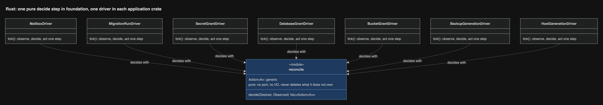

The host applier's and the mailbox component's ports:

