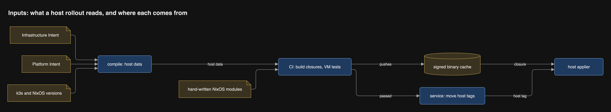
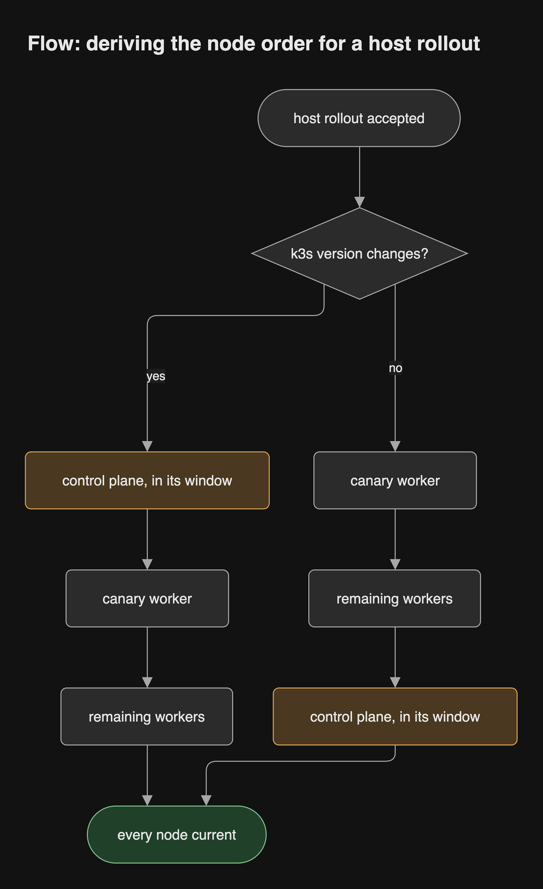
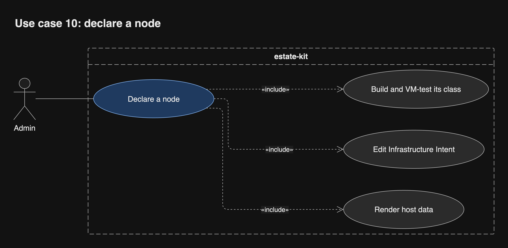
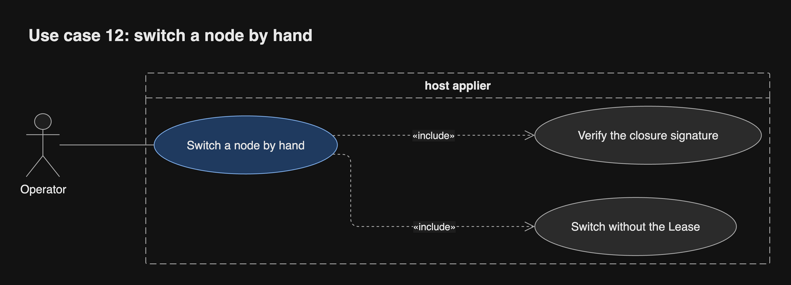

# Hosts

The same model and compiler that render Projects also render each NixOS node's
configuration. A separate host applier on every node switches it, one node at a
time, and reboots only inside its maintenance window.

## One model, two appliers

The split follows the failure domain, not the model. Flux applies Projects
inside the cluster. The host applier runs on the node itself, outside
Kubernetes, because it must update the nodes the cluster runs on, and must
still work when the cluster is down.

| | Projects | Hosts |
| --- | --- | --- |
| Authored in | Project Intent | Infrastructure Intent (sites, nodes, maintenance windows) |
| Compiler output | Kubernetes objects | Typed host data, consumed by hand-written NixOS modules |
| Gate before applying | Server-side dry-run | Build every closure, plus a NixOS VM test per Node class |
| Signed pointer | `render/
:prod` | `host/<node>:prod`, moved by the service |
| Applier | Flux | Host applier on each node |

## Where each host input comes from

## A host rollout

CI builds and signs every node's closure into an off-cluster binary cache and
runs the VM tests. Then the service moves the host tags. Each applier fetches
its closure first, which disrupts nothing. Only the switch and the reboot are
serialised, under a cluster-wide Lease, with pods leaving through the Eviction
API so PodDisruptionBudgets hold.

## States of the host applier

A reboot is needed only when the new generation's kernel or initrd differs from
the booted one. The maintenance window gates when a reboot starts. An unhealthy
node boots its previous generation and halts the rollout.

## Order of nodes

The order is derived from what the rollout changes:

- **The k3s version changes:** the control plane first, inside its window, then
  one canary worker, then the remaining workers.
- **Only the OS or host services change:** one canary worker, then the
  remaining workers, then the control plane last.

A check refuses any target that breaks the
[Kubernetes version skew policy](https://kubernetes.io/releases/version-skew-policy/):
a kubelet newer than the API server, or a minor version that jumps more than
one step. The [k3s upgrade guide](https://docs.k3s.io/upgrades/automated)
likewise upgrades servers before agents.

## Known limit: one control plane

`frankfurt-contabo-1` is the only control-plane node. While it switches or
reboots, inside its window, the API pauses: workloads keep serving, but Flux,
Flagger and the service wait. Moving to three servers is a separate decision.

## When the cluster is down

The host tags cannot move, and the Lease cannot be taken. A documented
break-glass command switches one node to a given generation by hand.

## Where the host parts run

Each node runs its own applier as a systemd service, beside k3s. The appliers
share nothing but the Lease in the API server; closures come from the cache,
pointers from ghcr.

## Inside the host applier

The agent is one reconcile step at a time over six ports, each with one
hand-written fake. A crash at any step resumes from the node's observed state.

## UC-10 Declare a node

An Admin adds or changes a node in Infrastructure Intent. Outcome: the node's
host data is rendered, and its class is built and VM-tested.

## UC-11 Roll out a host change

CI passes the host gate, and the service moves the host tags. Outcome: every
node runs the new generation, one at a time, rebooting only in its window.

## UC-12 Switch a node by hand

The cluster is down, so no tag can move and no Lease can be taken. An Operator
switches one node to a signed generation by hand. Outcome: the node runs that
generation; the Operator owns draining it.

## When an applier crashes mid-rollout

Every step is idempotent. A restarted applier reads the node's observed state
(is the Lease still mine, is the node cordoned) and resumes from there; a Lease
that expires frees the next node.

