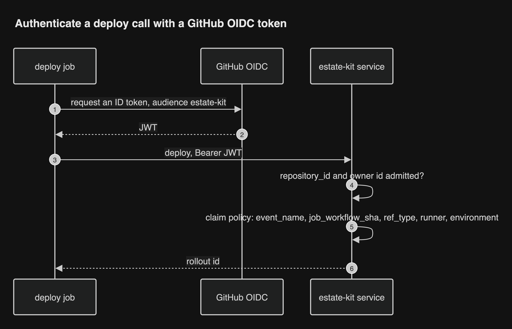

# Identity and access

Every caller that can change something proves who it is with an OIDC token.
One long-lived secret remains: the PAT that moves ghcr tags, because ghcr
refuses GitHub App tokens ([review](../research/review/README.md) D3). It lives in Vault.

## Who calls, with what

| Caller | Token | What the service checks |
| --- | --- | --- |
| Project CI | GitHub Actions OIDC token, audience `estate-kit` | A claim policy with pass and fail fixtures (D8): `repository_id` and `repository_owner_id` match the Project's admission; `job_workflow_sha` is the pinned estate-kit reusable workflow; `event_name` is on an allowlist; deploy needs `ref_type` tag, a GitHub-hosted runner and environment `production`; a PR may only plan or dry-run. `sub` is never used |
| CI after the exchange | Service-issued token | Scoped to one Project and one rollout, read-only on the stream |
| People in the UI | auth-api; estate-kit is a declared Client | Group claims map to viewer, operator or admin in Platform Intent. Operators pause, resume and roll back; admins change admissions |
| Flagger's Release Gate webhook | None: Flagger cannot send a projected service-account token | The gate only reads cluster state and changes nothing, so an unauthenticated call can learn health and nothing more (D9) |
| Flux | None: the service watches Flux's status instead of taking its events | Nothing to check (D9) |
| Service to Vault | Vault Kubernetes auth | The service's own service account |
| Service to GitHub | GitHub App installation token | Not OIDC: GitHub issues it per installation |
| Service to ghcr | A machine account's classic PAT, read from Vault | Write only on the render and host packages; a check fails on any other grant; rotated on a schedule (D3) |
| Service to the API server | Its own service account | Dry-run only: a ValidatingAdmissionPolicy refuses its writes unless `dryRun` is set (D4); it also holds the writer Lease |
| Host applier to the API server | A credential per node | Cordon, evict and the rollout Lease, limited by policy to its own node (D2) |

## Authenticating a deploy job

A GitHub OIDC token is short-lived, but a rollout can run longer. The job
exchanges its token once for a rollout token, and reconnects with that.

## Why repository_id and not the name

A renamed or recreated repository keeps its name but not its id. Binding
admission to `repository_id` means a new repository with an old name cannot
take a Project over.
