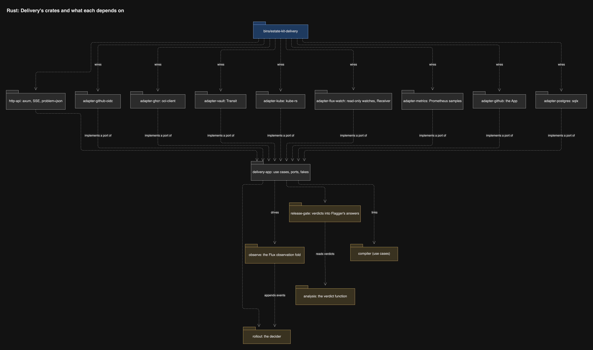
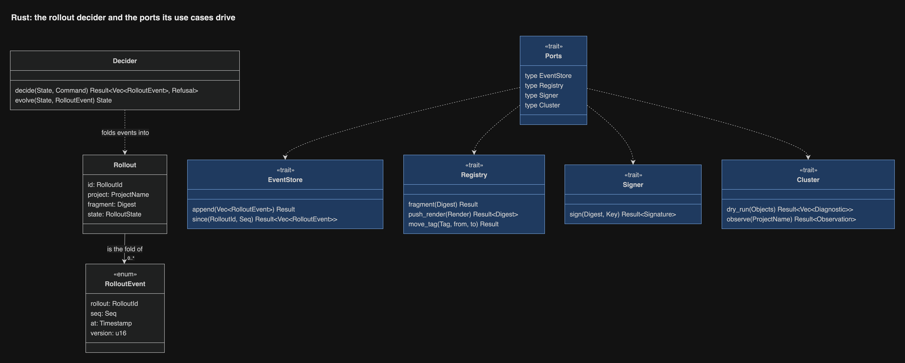

# Inside Delivery

Delivery is Rust ([record 13](../decisions/0013-every-program-is-rust.md)):
a thin orchestrator around ports. The `rollout` crate holds the logic as a
pure decider. `delivery-app` holds the use cases and the port traits. Every
adapter crate adapts one outside system, and each port has exactly one
hand-written fake that passes the same contract suite as its adapter
([record 68](../decisions/0068-every-fake-passes-its-port-s-contract-suite.md)).
[End to end, crate by crate](end-to-end.md) follows a deploy through them.

## Crates

| Crate | Layer | Holds | Outside system |
| --- | --- | --- | --- |
| `rollout` | domain | The Rollout decider and its events, the upcasters (once a second version exists), the composition queue policy | None |
| `observe` | domain | The pure fold of Flux, Flagger and object observations into Rollout events ([record 94](../decisions/0094-flux-stays-the-one-applier-observed-closely-and-an-estate-kit-applier-waits-for-a-review-trigger.md)) | None |
| `analysis` | domain | The pure verdict function: pass, fail or inconclusive ([record 102](../decisions/0102-analysis-is-a-pure-verdict-function-and-an-inconclusive-verdict-holds.md)) | None |
| `release-gate` | domain | The Release Gate's answer from a ClusterObservation; probing and warmup rules | None |
| `delivery-app` | application | Deploy, DryRun, Plan, Pause, Resume, Rollback, Admit, Gate; the port traits and their fakes | None |
| `adapter-oidc` | adapter | The CI token's claim policy | GitHub's OIDC discovery |
| `adapter-ghcr` | adapter | Fragments, renders, tags, registered digests | ghcr, with a machine account's token from a mounted Secret |
| `adapter-vault` | adapter | Signs a render or host tag with its own Transit key | Vault Transit |
| `adapter-kube` | adapter | Server-side dry-run as Delivery's own identity; the ClusterState snapshot; the writer Lease; the Pause object | API server, through kube-rs |
| `adapter-flux-watch` | adapter | The read-only watches of Flux and Flagger objects, inventories and Events, and the Receiver call ([record 94](../decisions/0094-flux-stays-the-one-applier-observed-closely-and-an-estate-kit-applier-waits-for-a-review-trigger.md)) | API server, through kube-rs; the Project's Flux Receiver |
| `adapter-metrics` | adapter | Read-only samples for analysis ([record 102](../decisions/0102-analysis-is-a-pure-verdict-function-and-an-inconclusive-verdict-holds.md)) | Prometheus |
| `adapter-forge-github` | adapter | Deployment status, check runs | GitHub App |
| `adapter-postgres` | adapter | The append-only rollout event log and the job table | A database on the shared platform-postgres |
| `http-api` | adapter | axum routes from the OpenAPI document, SSE, problem+json, authentication layers | None |
| `bins/estate-kit-delivery` | binary | Configuration and wiring. It serves no UI: Observation's binary does | None |

The use cases take one `P: Ports` type parameter whose associated types name
each port, so `main` wires the real adapters and tests wire the fakes with no
dynamic dispatch and no generic parameter per port.

## The rollout core

A rollout is a fold over its events, so its state can always be rebuilt from
the log. `rollout::decide(&State, Command) -> Result<Vec<Event>, Refusal>`
and `rollout::evolve(State, &Event) -> State` are pure, and they are the
mutation-tested heart of Delivery. The use case loads the events, decides,
appends, and only then acts on the outside world.

The queue runs one composition at a time; triggers that arrive meanwhile merge
into the next composition, and each waiting deploy job learns which
composition carries its fragment.

## The event log

One table of rollout events in a database on the shared platform-postgres:
rollout id, sequence, type, version, time, payload, the [predecessor
digest](../../CONTEXT.md) each row carries of the row before it in the same
Rollout, and, on an event that
reconciliation appended after a crash, a reconstructed marker naming the
Observation it came from ([record 145](../decisions/0145-every-rollout-event-row-carries-a-predecessor-digest.md)).
A unique (rollout id, sequence) key refuses a
duplicate, and an append whose predecessor digest does not name the last row
the writer read is refused, so a gap or a reorder is detected at the log. Two database roles touch it: Delivery's, which can insert and
select only, and the retention job's, which can delete and is held by the job
alone ([record 23](../decisions/0023-a-rollout-is-an-append-only-event-log-on-the-shared-postgres.md)). Its schema ships as a
changelog in a migration image that alone holds the owner role, as every
estate service's does ([workspace ADR-0021](https://github.com/JorisJonkers-dev/workspace/blob/main/docs/decisions/ADR-0021-liquibase-runner-is-the-one-migration-path.md)); Delivery never migrates its own
database. The existing dump and restore check covers it. A deploy job's stream
resumes from a sequence number, and the UI reads history through Delivery's API, never the table.
Pause and held state stay in the Project's cluster object.

## One writer

Delivery runs one pod with strategy Recreate, so an update never runs two,
and it takes a coordination Lease right before it signs or moves a tag, so a
stray second pod cannot write ([review](../research/review/README.md) D9,
[record 63](../decisions/0063-delivery-has-one-writer-and-reconciles-from-observed-state.md)). On
startup it does not trust the log alone: it rebuilds each unfinished rollout
from the Project's tag in ghcr and from Flux and Flagger status, or ends it
with an Abandoned event. Flux keeps serving the last tags meanwhile. The one
tag Delivery never moves is its own: the Environment tag of Delivery's own
render moves only under the maintainer's CLI, and the [bootstrap
step](../../CONTEXT.md), not Delivery, applies its Deployment
([record 144](../decisions/0144-delivery-holds-no-actions-write-and-dispatches-no-workflow-and-its-own-deployment-is-applied-by-a-bootstrap-step-that-verifies-the-render-signature.md)).

## The compiler, in-process

Delivery calls `compiler::compose` on a blocking thread under
`catch_unwind`, with the YAML reader's budget and a deadline
([record 18](../decisions/0018-delivery-links-the-compiler.md)). A panic or
a breached budget fails that composition with an internal problem; the next
composition runs normally.

## What it reads from the cluster

Delivery observes Flux closely
([record 94](../decisions/0094-flux-stays-the-one-applier-observed-closely-and-an-estate-kit-applier-waits-for-a-review-trigger.md)):
it watches, read-only, the Project's Kustomizations, OCIRepository and Canary
objects, the Events in `flux-system` and the Project's namespaces, and every
object in each step's inventory, and it writes no Flux object. Each observation
becomes a versioned Rollout event with its sequence number
([record 23](../decisions/0023-a-rollout-is-an-append-only-event-log-on-the-shared-postgres.md)),
so the Rollout is the fold of what Delivery saw, never Flux's summary as the
truth. Delivery computes each object's health itself, by the kstatus rules, and
correlates observations by the render digest Flux reports as applied. It
watches rather than taking Flux's or Flagger's event notifications, which are
pushes it cannot authenticate. The Release Gate's webhook is different: Flagger
asks a question, and the answer changes nothing in the cluster.

The fold lives in `observe`, a domain crate; the read-only watches and the
Receiver call live in `adapter-flux-watch`
([record 94](../decisions/0094-flux-stays-the-one-applier-observed-closely-and-an-estate-kit-applier-waits-for-a-review-trigger.md)).
After the Publication point, Delivery calls the Project's Flux Receiver, so
Flux fetches the new render at once; the reconcile interval stays as the
fallback if the call is lost. What stays opaque is said, not hidden: the
stream can say a render was not picked up, but not why, because Flux's own
queue is not visible; Flux's errors are shown verbatim, not parsed.

The Release Gate answers Flagger from cluster state
only, so no unauthenticated request can change anything. Its two writes, the
unsuspend of a migration Job and the Application's record, are made by Delivery's reconcile under the writer Lease with a service account of their own
([record 74](../decisions/0074-the-release-gate-and-observation-each-have-a-named-write.md)). Delivery dry-runs
as its own identity; a ValidatingAdmissionPolicy refuses any write from that
identity unless `dryRun` is set ([security](security.md)).

## The Observation views

The dashboard's read views (units, pods, containers, alerts and silences,
logs, health, checks) are a separate context in a separate process
([record 50](../decisions/0050-six-bounded-contexts-in-five-layers.md)): the
`observation-app` crate and one adapter per source, wired by
`bins/estate-kit-observation`, which runs as its own Deployment. It does not
link `adapter-kube`, `adapter-vault` or `adapter-ghcr`; it has its own kube
adapter, `adapter-observation-kube`, with a service account that can only read.
It holds no Vault, ghcr or signing credential and none that can deploy, pause
or roll back. It has one write: Alertmanager silences, with a credential for
that API alone ([record 74](../decisions/0074-the-release-gate-and-observation-each-have-a-named-write.md)).
A source that is down greys out its panel without touching a rollout.

Observation reads rollout history and events from Delivery's HTTP API
through `adapter-delivery-api`, so Delivery's event store stays private to
Delivery.

**The UI.** The Vue UI is embedded in the Observation binary, because most of
its views are Observation's. The browser reaches Delivery's API directly,
on Delivery's own route behind the same Gate; Observation's binary does not
proxy it. A Pause or Rollback therefore carries the signed-in Operator's
Principal to Delivery, which authorizes it, and Observation never holds a
credential that could do it for them. If Delivery is down, the rollout
panels grey out and the rest of the UI keeps working.
