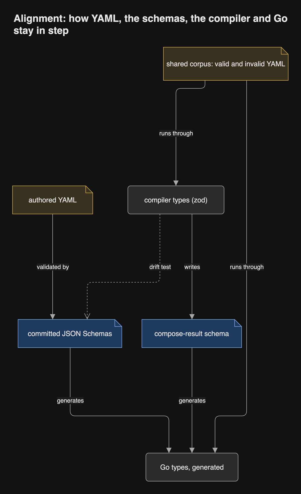

# Inside the compiler

The compiler is Rust ([record 13](../decisions/0013-every-program-is-rust.md))
and implements deploy-kit's 1.0 specification
([record 67](../decisions/0067-the-compiler-is-written-to-the-1-0-contract.md)).
Its design is deploy-kit's: a chain of typed models, one pure step per arrow,
ports for everything that touches the world. Cargo's crate graph replaces
dependency-cruiser. The same `compiler` crate serves the CLI in CI and the
service in the cluster ([record 18](../decisions/0018-the-service-links-the-compiler.md)).
How each step carries the MDE course's lessons is
[Transformations without a DSL](transformations.md).

## Crates

One crate per step and one per render target. A step crate depends only on
the model crates and the foundation, so no step can import another, and a
mutant rebuilds only its own small crate.

## The pipeline

Each step turns one typed model into the next. Every step can add to the
diagnostic list; none stops at the first error.

## The authored model

The types carry the vocabulary of `CONTEXT.md` unchanged. Names are newtypes
(`ApplicationId`, `ProcessName`, `SurfaceName`), and every finite set is a
closed enum (`Lifecycle`, `Audience`, `AccessTier`).

## Pipeline types and ports

The pinned input set is one type, so the closed set of inputs is visible in one
place. Hashing is a trait, so no step reaches for ambient crypto.

## Data structures

- **Determinism.** Maps are `BTreeMap`, never `HashMap` (a clippy
  `disallowed-types` rule in every compiler crate), so iteration order and
  output bytes are stable. Two renders of the same inputs compare equal byte
  for byte.
- **References by id.** The dependency graph holds `ApplicationId`s and
  indices, not pointers, so it can be checked for cycles and sorted without
  lifetimes.
- **Spanned parse, then schema, then types.** YAML is parsed into a tree that
  keeps a model path and span on every node, validated against the committed
  JSON Schema with every error collected, and only then converted into types.
  serde never sees invalid input. Which crate does the spanned parse is
  settled by a spike.
- **Errors.** Authored-input problems are `Diagnostic`s collected in a list.
  Internal bugs are panics, covered by tests.

## Alignment with YAML and the schemas

The committed JSON Schemas and their accept/refuse corpus are the contract
([deploy-kit ADR 0088](https://github.com/JorisJonkers-dev/deploy-kit/blob/main/docs/adr/architecture/0088-the-committed-schemas-and-their-corpus-are-the-contract.md)).
The read step validates against the schemas; a corpus-agreement test runs
every corpus document through the schema and through the typed conversion. The
types must refuse everything the schema refuses and may refuse more, and the
whole diagnostic set recorded for each document must match. No language generates its types from the schemas,
and no test compares generated schema bytes. The service's routes are held to
the committed OpenAPI document the same way, and the Vue client is generated
from it.

## The CLI's output

`estate-kit` reads fragments from a directory and writes renders and
diagnostics to an output directory. With `--json` it prints one document,
validated against a committed schema, that the reusable workflows read for
annotations and summaries. The service does not read it: it calls the
`compiler` crate directly. Renders are written in a canonical YAML style
specified on one page ([record 64](../decisions/register.md)).

## No render cache

There is no render cache (review D9). A cache keyed by the input digest missed
on every lockstep release, because the compiler version is part of the key. The
render key stays as provenance: the hash of the fragment digest, the Platform
Intent digest, the ClusterState digest, the compiler version and the Surface
declarations that Link reads from other Projects. When a
render's digest equals the one already behind the Project's tag, the service
publishes nothing and moves nothing. Inside one run, each fragment is parsed
once.

### The two-Project fixture

One fixture settles that the Surface facts belong in the render key. It has two
Projects: a provider that declares a Surface, and a consumer whose Application
depends on it. The test composes both, changes only the provider's Surface (its
port), and composes again. The consumer's fragment, Platform Intent, ClusterState
snapshot and compiler version are the same, yet its render key must change; a
key built from those four alone would not. The provider's render key changes
too. A second case changes a Surface that no Project consumes and asserts that
every other Project's render key stays the same.
