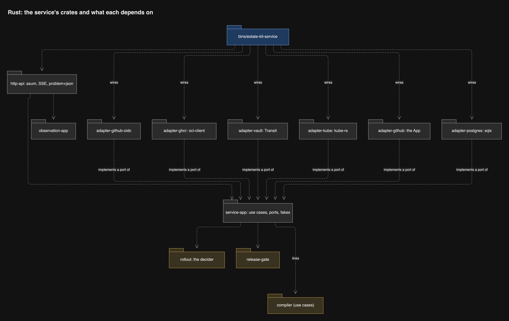
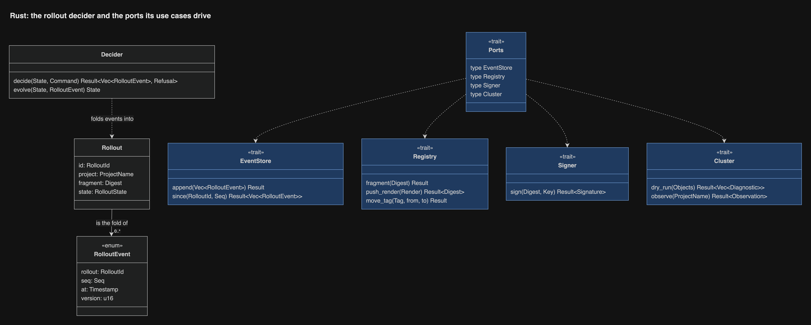

# Inside the service

The service is Rust ([record 13](../decisions/0013-every-program-is-rust.md)):
a thin orchestrator around ports. The `rollout` crate holds the logic as a
pure decider. `service-app` holds the use cases and the port traits. Every
adapter crate adapts one outside system, and each port has exactly one
hand-written fake that passes the same contract suite as its adapter
([record 68](../decisions/0068-every-fake-passes-its-port-s-contract-suite.md)).
[End to end, crate by crate](end-to-end.md) follows a deploy through them.

## Crates

| Crate | Layer | Holds | Outside system |
| --- | --- | --- | --- |
| `rollout` | domain | The Rollout decider and its events, the upcasters, the composition queue policy | None |
| `release-gate` | domain | The Release Gate's answer from a ClusterObservation; probing and warmup rules | None |
| `service-app` | application | Deploy, DryRun, Plan, Pause, Resume, Rollback, Admit, Gate; the port traits and their fakes | None |
| `adapter-github-oidc` | adapter | The CI token's claim policy | GitHub's OIDC discovery |
| `adapter-ghcr` | adapter | Fragments, renders, tags, registered digests | ghcr, with a machine account's token from a mounted Secret |
| `adapter-vault` | adapter | Signs a render or host tag with its own Transit key | Vault Transit |
| `adapter-kube` | adapter | Server-side dry-run as the service's own identity; Flux and Flagger status; the ClusterState snapshot; the writer Lease; the Pause object | API server, through kube-rs |
| `adapter-github` | adapter | Deployment status, check runs | GitHub App |
| `adapter-postgres` | adapter | The append-only rollout event log and the job table | A database on the shared platform-postgres |
| `http-api` | adapter | axum routes from the OpenAPI document, SSE, problem+json, authentication layers | None |
| `bins/estate-kit-service` | binary | Configuration, wiring, the embedded Vue assets | None |

The use cases take one `P: Ports` type parameter whose associated types name
each port, so `main` wires the real adapters and tests wire the fakes with no
dynamic dispatch and no generic parameter per port.

## The rollout core

A rollout is a fold over its events, so its state can always be rebuilt from
the log. `rollout::decide(&State, Command) -> Result<Vec<Event>, Refusal>`
and `rollout::evolve(State, &Event) -> State` are pure, and they are the
mutation-tested heart of the service. The use case loads the events, decides,
appends, and only then acts on the outside world.

The queue runs one composition at a time; triggers that arrive meanwhile merge
into the next composition, and each waiting deploy job learns which
composition carries its fragment.

## The event log

One table of rollout events in a database on the shared platform-postgres:
rollout id, sequence, type, version, time, payload. Its schema ships as a
changelog in a migration image that alone holds the owner role, as every
estate service's does ([workspace ADR-0021](https://github.com/JorisJonkers-dev/workspace/blob/main/docs/decisions/ADR-0021-liquibase-runner-is-the-one-migration-path.md)); the service never migrates its own
database. The existing dump and restore check covers it. A deploy job's stream
resumes from a sequence number, and the UI reads history from the same table.
Pause and held state stay in the Project's cluster object.

## One writer

The service runs one pod with strategy Recreate, so an update never runs two,
and it takes a coordination Lease right before it signs or moves a tag, so a
stray second pod cannot write ([review](../research/review/README.md) D9,
[record 63](../decisions/0063-the-service-has-one-writer-and-reconciles-from-observed-state.md)). On
startup it does not trust the log alone: it rebuilds each unfinished rollout
from the Project's tag in ghcr and from Flux and Flagger status, or ends it
with an Abandoned event. Flux keeps serving the last tags meanwhile.

## The compiler, in-process

The service calls `compiler::compose` on a blocking thread under
`catch_unwind`, with the YAML reader's budget and a deadline
([record 18](../decisions/0018-the-service-links-the-compiler.md)). A panic or
a breached budget fails that composition with an internal problem; the next
composition runs normally.

## What it reads from the cluster

The service follows Flux by watching Kustomization and OCIRepository status,
not by taking Flux events: Flux and Flagger cannot send projected
service-account tokens. The Release Gate answers Flagger from cluster state
only, so no unauthenticated request can change anything. Its two writes, the
unsuspend of a migration Job and the Application's record, are made by the
service's reconcile under the writer Lease with a service account of their own
([record 74](../decisions/0074-the-release-gate-and-observation-each-have-a-named-write.md)). The service dry-runs
as its own identity; a ValidatingAdmissionPolicy refuses any write from that
identity unless `dryRun` is set ([security](security.md)).

## The Observation views

The dashboard's read views (units, pods, containers, alerts and silences,
logs, health, checks) are a separate context in the same binary: the
`observation-app` crate and one adapter per source. They hold no credential
that can deploy, pause or roll back, and one write: Alertmanager silences, with a
credential for that API alone ([record 74](../decisions/0074-the-release-gate-and-observation-each-have-a-named-write.md)), and a source that is down greys out its
panel without touching a rollout.
