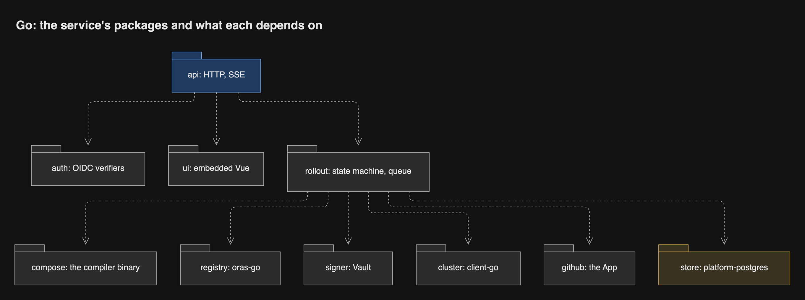
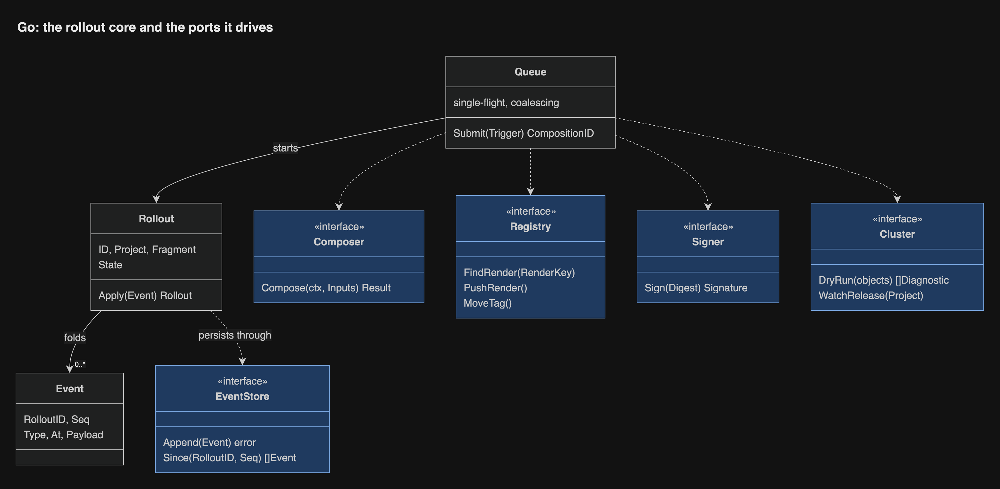

# Inside the service (Go)

The service is a thin orchestrator around ports. The rollout package holds the
logic. Every other package adapts one outside system, and each port has exactly
one hand-written fake.

## Packages

| Package | Holds | Outside system |
| --- | --- | --- |
| `api` | HTTP handlers and the SSE event stream | None |
| `auth` | GitHub OIDC with the claim policy, and auth-api sessions | OIDC discovery endpoints |
| `rollout` | The rollout state machine and the composition queue | None |
| `compose` | Runs the compiler binary, reads `result.json` | The binary |
| `registry` | Fragments, renders, tags, registered digests | ghcr, through oras-go, with a machine account's token from Vault |
| `signer` | Signs a render or host tag with its own key | Vault Transit |
| `cluster` | Server-side dry-run as the service's own identity, Flux and Flagger status, the writer Lease | API server, through client-go |
| `github` | Deployment status, check runs, workflow dispatch | GitHub App |
| `store` | The append-only rollout event log | A database on the shared platform-postgres |
| `ui` | The embedded Vue assets | None |

## The rollout core

A rollout is a fold over its events, so its state can always be rebuilt from
the log. The queue runs one composition at a time; triggers that arrive
meanwhile merge into the next composition, and each waiting deploy job learns
which composition carries its fragment.

## The event log

One table of rollout events in a database on the shared platform-postgres:
rollout id, sequence, type, version, time, payload. The existing dump and
restore check covers it. A deploy job's stream resumes from a sequence number,
and the UI reads history from the same table. Pause and held state stay in the
Project's cluster object.

## One writer

The service runs one pod with strategy Recreate, so an update never runs two,
and it takes a coordination Lease right before it signs or moves a tag, so a
stray second pod cannot write ([review](../research/review/README.md) D9). On
startup it does not trust the log alone: it rebuilds each unfinished rollout
from the Project's tag in ghcr and from Flux and Flagger status, or ends it
with an Abandoned event. Flux keeps serving the last tags meanwhile.

## What it reads from the cluster

The service follows Flux by watching Kustomization and OCIRepository status,
not by taking Flux events: Flux and Flagger cannot send projected
service-account tokens. The Release Gate answers Flagger from cluster state
only, so no unauthenticated request can change anything. The service dry-runs
as its own identity; a ValidatingAdmissionPolicy refuses any write from that
identity unless `dryRun` is set ([security](security.md)).
