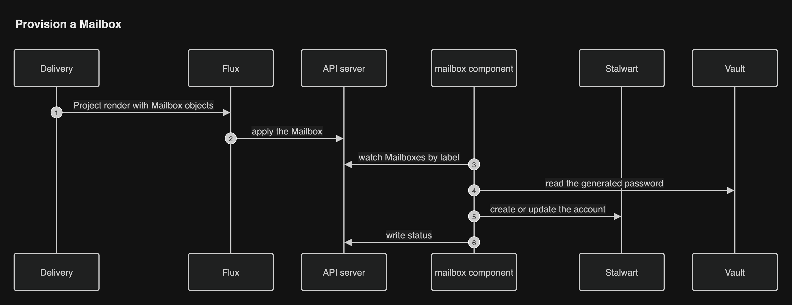
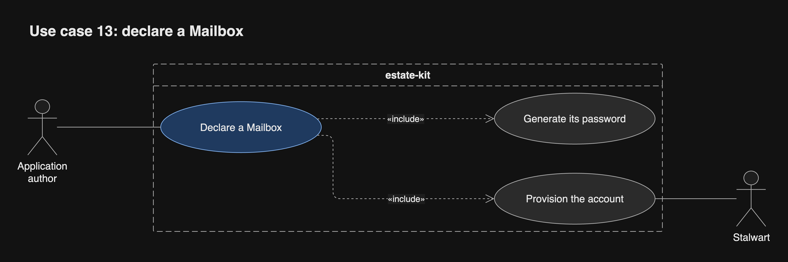
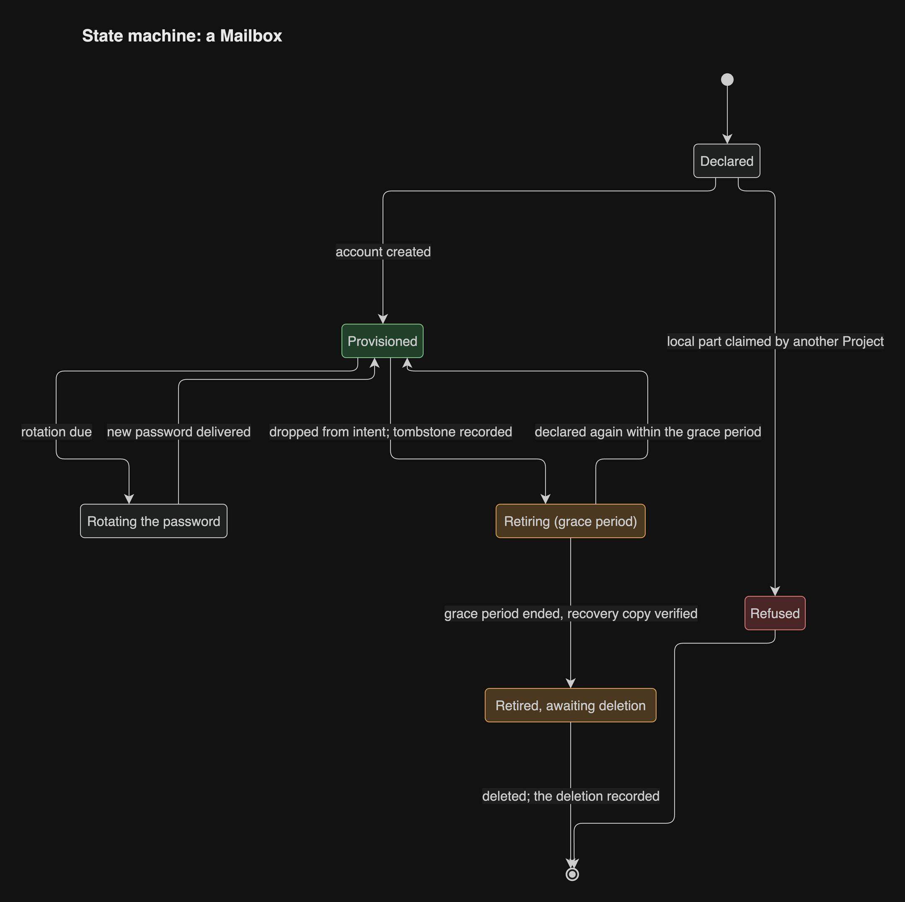
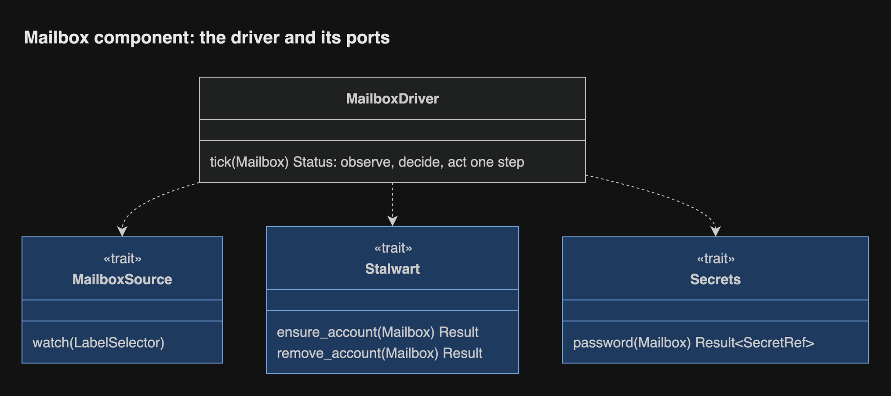

# Mail and components

Six helpers are estate-kit components: Rust binaries that build their own
images in the same lockstep version ([record 13](../decisions/0013-every-program-is-rust.md)).
They are ported after the cutover, one at a time; each keeps running as its
Go or Python program until its rewrite is due.
Each Project renders the objects they act on, so a Project controls everything
about itself. They share one decide step in `reconcile`: read what a render declares,
compare it with one outside system, change what differs, and never delete what
they do not own; each component's `-app` crate drives it through its own ports ([The Rust workspace](rust-workspace.md#bounded-contexts)).

## Components

| Component | Replaces | Acts on |
| --- | --- | --- |
| `migration-run` | liquibase-runner (Go around the Liquibase JVM); the JVM and squawk stay in the image | A Project's managed migrations, `up` and `down` per revision |
| `secret-grant` | delivery's Vault policy job (Go) | A Project's Vault policies, auth roles and generated keys |
| `database-catalog` | delivery's postgres-catalog (Go) | A Project's Postgres roles, databases, grants and Vault database roles |
| `bucket-catalog` | delivery's garage-catalog (Go) | A Project's Garage buckets, keys and grants |
| `backup` | delivery's backup and offcluster jobs (Go) | A Project's backup generations, and for a multi-tenant Project one per Tenant, made of Tenant exports ([record 82](../decisions/0082-backups-are-per-tenant-generations-and-mirrors-refresh-staging-and-development.md)), as Kopia snapshots in its Environment's locked repository ([record 115](../decisions/0115-backups-are-kopia-snapshots-in-one-locked-repository-per-environment-on-an-eu-object-store-with-wal-archived-beside-them.md)), and the weekly restore rehearsal |
| `mailbox` | stalwart-provisioner (Python, jq and sh) | A Project's Mailbox objects, through Stalwart's management API |

Every reconciler estate-kit owns passes crash-point, stale-read and safety tests
before it takes production responsibility ([record 104](../decisions/0104-every-reconciler-estate-kit-owns-passes-crash-point-stale-read-and-safety-tests-before-it-takes-production-responsibility.md)). The harness and the tests for the four destructive reconcilers (`migration-run`, `backup`, `database-catalog` and `mailbox`) exist before the cutover's first handover, and each of the four passes them before it replaces its Go or Python program.

## Mailboxes

An Application lists the addresses it needs by local part. The platform derives
everything else: the address on the estate's mail domain, a generated password
as a Generated key, and delivery as env or file like any Grant.

```yaml
applications:
  notifier:
    mail: [noreply]
  api:
    mail: [noreply]     # same local part in one Project: one shared Mailbox
```

- **Within one Project**, the same local part names one shared Mailbox.
- **Across Projects**, the same local part is refused with a contention
  diagnostic that points at both YAML lines, the other as a related location
  ([record 71](../decisions/0071-a-diagnostic-is-a-coded-problem-with-typed-locations.md)). Each Mailbox has exactly one
  owning Project.
- **Open:** how a Mailbox is shared beyond its Project, if ever, needs its own
  design so that it stays easy to read and short to write.

For a multi-tenant Project the Mailbox also exists on each domain a Tenant has
verified, and a Tenant without one sends as the Project's product domain. That
is decided in [record 84](../decisions/0084-a-tenant-sends-mail-as-its-product-domain-until-it-verifies-its-own.md),
and [Tenancy](tenancy.md#mail) explains it.

## How a Mailbox is provisioned

Each Project's render carries one Mailbox custom resource per Mailbox, in its
own unit. The mailbox component watches them by label and reconciles Stalwart.
Adding a Project re-renders nothing else.



## Retire policy and tombstone

When a Mailbox, or any other durable object, leaves Intent, it is not deleted
by Flux. Prune-protected kinds (namespaces, claims with recoverable or
irreplaceable volumes, Mailboxes, buckets, databases) carry the prune-disabled
mark ([record 105](../decisions/0105-removal-is-a-retire-lifecycle-with-durable-retirement-tombstones-and-declared-moves-and-prune-protected-kinds-never-prune.md)).

The owning component records a Retirement tombstone: what is retiring, since
when, and under which policy. The tombstone is a custom resource of the owning
component, so it is restored with the datastore before the components resume.
The policy is set per kind and per class of data: suspend the object, wait a
grace period, verify a recovery copy, then let the owning component delete it
and record the deletion. The grace period is 30 days unless the policy states
another. Declaring the object again within the grace period cancels the
retirement. A tombstone survives a render change, a lost render and a restore,
and a component applies its tombstones before restored data serves, so a
restore never brings back what was retired.

Moves are declared, never inferred. A renamed Mailbox local part is a
`moved_from` in Intent. A removal and an addition of the same kind under the
same owner, with no declared move, is refused by the plan until the author
declares the move or confirms the retirement. So a Mailbox that leaves Intent,
or whose Project leaves, is retired, never removed by a render change, and a
rename moves the account, as
[record 33](../decisions/0033-a-mailbox-is-declared-by-its-local-part-and-owned-by-one-project.md)
now says.

## UC-13 Declare a Mailbox

An Application author adds a local part to `mail`. Outcome: the address exists
in Stalwart, and its password reaches the Application like any Grant.



## States of a Mailbox



## Inside the mailbox component

One reconciler over three ports: where Mailboxes come from, Stalwart, and the
secret store.


