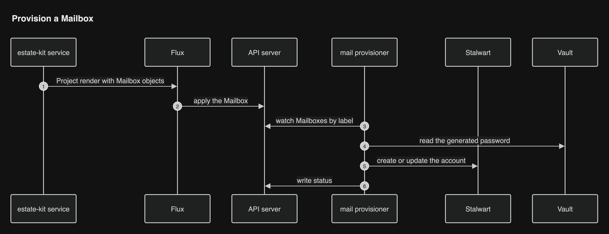
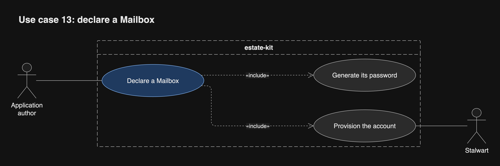
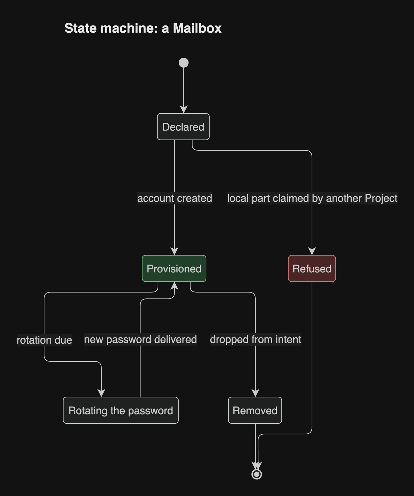
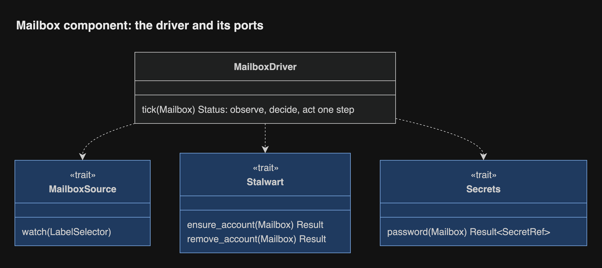

# Mail and components

Six helpers are estate-kit components: Rust binaries that build their own
images in the same lockstep version ([record 13](../decisions/0013-every-program-is-rust.md)).
Each Project renders the objects they act on, so a Project controls everything
about itself. They share one reconcile loop: read what a render declares,
compare it with one outside system, change what differs, and never delete what
they do not own ([The Rust workspace](rust-workspace.md#bounded-contexts)).

## Components

| Component | Replaces | Acts on |
| --- | --- | --- |
| `migration-runner` | liquibase-runner (Go around the Liquibase JVM); the JVM and squawk stay in the image | A Project's managed migrations, `up` and `down` per revision |
| `secret-grant` | delivery's Vault policy job (Go) | A Project's Vault policies, auth roles and generated keys |
| `database-catalog` | delivery's postgres-catalog (Go) | A Project's Postgres roles, databases, grants and Vault database roles |
| `bucket-catalog` | delivery's garage-catalog (Go) | A Project's Garage buckets, keys and grants |
| `backup` | delivery's backup and offcluster jobs (Go) | A Project's backup generations and their encrypted off-cluster copies |
| `mail-provisioner` | stalwart-provisioner (Python, jq and sh) | A Project's Mailbox objects, through Stalwart's management API |

## Mailboxes

An Application lists the addresses it needs by local part. The platform derives
everything else: the address on the estate's mail domain, a generated password
as a Generated key, and delivery as env or file like any Grant.

```yaml
applications:
  notifier:
    mail: [noreply]
  api:
    mail: [noreply]     # same local part in one Project: one shared Mailbox
```

- **Within one Project**, the same local part names one shared Mailbox.
- **Across Projects**, the same local part is refused with a contention
  diagnostic that points at both YAML lines. Each Mailbox has exactly one
  owning Project.
- **Open:** how a Mailbox is shared beyond its Project, if ever, needs its own
  design so that it stays easy to read and short to write.

## How a Mailbox is provisioned

Each Project's render carries one Mailbox custom resource per Mailbox, in its
own unit. The mail provisioner watches them by label and reconciles Stalwart.
Adding a Project re-renders nothing else.



## UC-13 Declare a Mailbox

An Application author adds a local part to `mail`. Outcome: the address exists
in Stalwart, and its password reaches the Application like any Grant.



## States of a Mailbox



## Inside the mail provisioner

One reconciler over three ports: where Mailboxes come from, Stalwart, and the
secret store.


