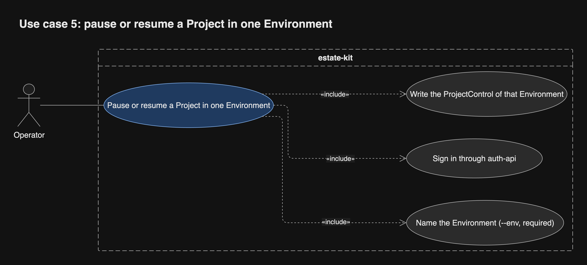
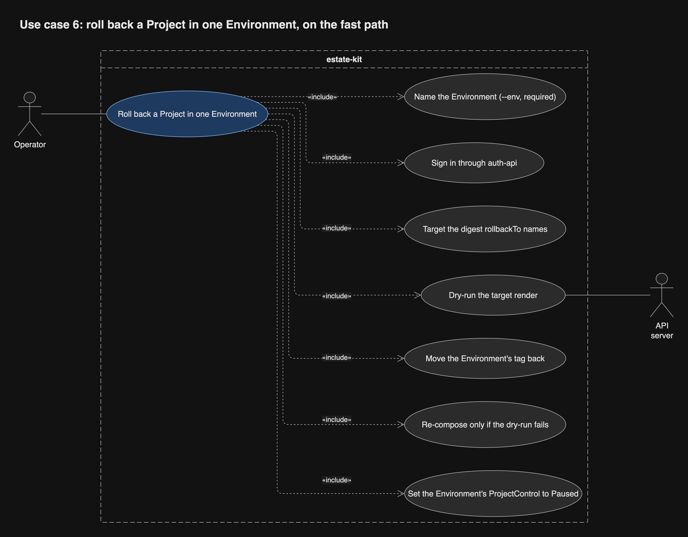
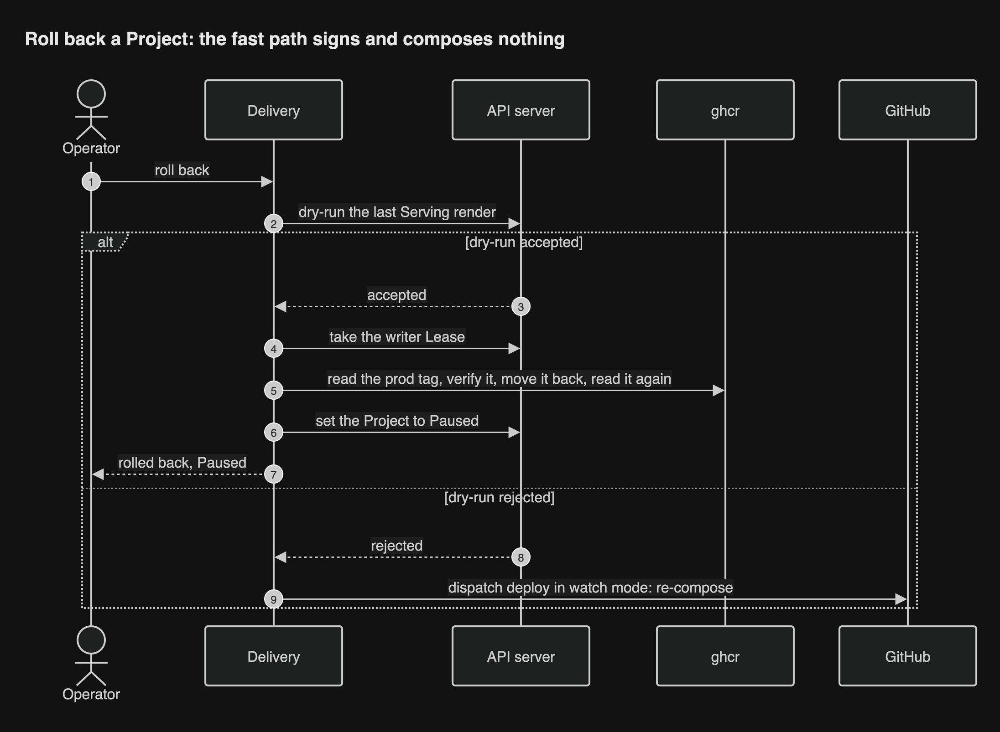
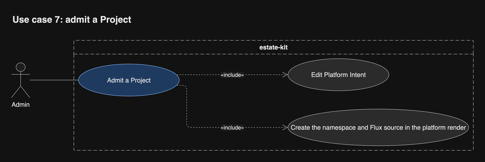
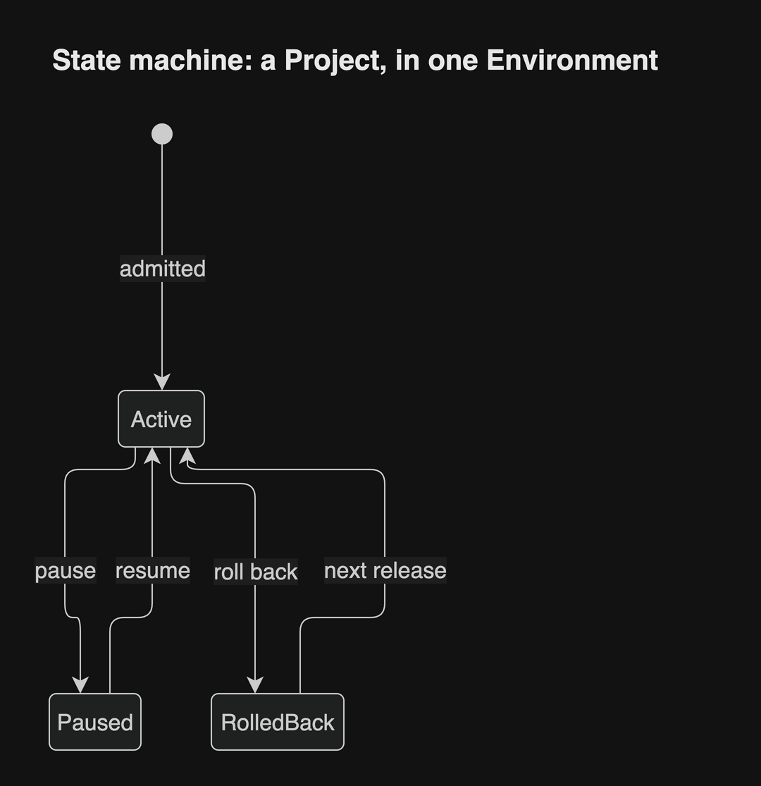

# Operating the estate

Operators act through the UI or the CLI ([record 113](../decisions/0113-every-ui-action-is-a-cli-command-with-the-same-identifier.md)). Every rollout they start still shows up as a Deployment in the Project's own repository: a Project's workflow runs because the Project started it, never because Delivery dispatched it, for Delivery holds no `actions:write` ([record 144](../decisions/0144-delivery-holds-no-actions-write-and-dispatches-no-workflow-and-its-own-deployment-is-applied-by-a-bootstrap-step-that-verifies-the-render-signature.md)).

## Low-attention defaults

The estate states its defaults for a low-attention week, and every default fails safe ([record 86](../decisions/0086-the-estate-states-its-defaults-for-a-low-attention-week.md)). During a week when the maintainer's attention varies — a holiday, an illness or a busy week elsewhere — Projects still release, nightly jobs still run, and Flux, Flagger and the components keep acting. What happens then is decided by defaults, not by anyone watching.

Every situation the estate can reach without the maintainer has a stated default, and every default fails safe: it blocks, holds or keeps the last good state, and it alerts. A default never widens what changes, never retries a move of traffic or a destructive step on its own, and never warns and carries on. An unattended step that destroys data proceeds only where a recovery copy outlives it. A low-attention week costs throughput, not correctness.

The defaults are this table. A new situation gets its row, and its default, in the record that creates it. The rows for Sequence tags wait for [record 98](../decisions/0098-the-live-pointer-is-an-immutable-sequence-tag-that-flux-selects-by-version.md), which is Proposed.

| Situation | Default |
| --- | --- |
| A dry-run fails, or an object is unverifiable for a reason other than construction | Block the move; never warn and continue |
| Objects are Unverifiable by construction | Publish the objects they depend on first; dry-run the rest after |
| An Analysis verdict is inconclusive | Hold; never promote; alert when the Held deadline passes |
| A Rollout ends Held | The old version keeps serving; nothing retries on its own |
| ProjectControl is missing or unreadable | Read as Paused |
| A step's outcome is unknown after a crash | Rebuild from observed state; never replay a write on the log's word |
| A composition input moved during the run | Publish nothing; compose again |
| The applied revision trails the latest published one for 1 hour | Alert; running workloads keep serving |
| A credential is expired or cannot be verified | Fail closed |
| Vault is sealed | Nothing is signed; a Rollback still works |
| Delivery is down | Nothing new deploys; Flux keeps serving the last renders |
| A migration fails and its Project database is marked failed | No release of that Project in that Environment until an Operator retries the migration or requests a Roll-forward |
| A lock or prepare-restore Tenant hook fails | The Tenant operation stops before any data changes |
| A Suspended Tenant reaches the end of its grace period | The Purge proceeds; its Tenant exports go at once, and whole-database backups that hold its rows remain until their retention ends |
| A Retire grace period ends | Delete only after a verified recovery copy exists |
| A backup reconciler is down | Alert; nothing else changes |
| A node class has no rehearsed fallback | No automatic host rollout for that class |
| Observation of an Operation is lost | The CI job exits with its own code; the Operation continues |

## Rollouts no Project run started

A Platform Intent change, the nightly recompose or a Rollback from the UI:
Delivery composes on its own and starts the Rollout itself, streaming it live
to the UI, and writes nothing into any forge to start it: it dispatches no
Project's workflow and its GitHub App holds no `actions:write`
([record 144](../decisions/0144-delivery-holds-no-actions-write-and-dispatches-no-workflow-and-its-own-deployment-is-applied-by-a-bootstrap-step-that-verifies-the-render-signature.md)).
The fragment scan that heals missed triggers runs on a short interval: a
fragment newer than the last composition triggers the next composition queue
row on its own
([record 73](../decisions/0073-the-composition-queue-is-a-row-in-a-postgres-job-table.md)),
and after the Publication point the Project's Flux Receiver call makes Flux
fetch the new render at once, with the reconcile interval as the fallback
([record 94](../decisions/0094-flux-stays-the-one-applier-observed-closely-and-an-estate-kit-applier-waits-for-a-review-trigger.md)).
The Rollout shows as a Deployment through the forge projection, with no run,
because Delivery never starts one ([record 144](../decisions/0144-delivery-holds-no-actions-write-and-dispatches-no-workflow-and-its-own-deployment-is-applied-by-a-bootstrap-step-that-verifies-the-render-signature.md)).

## UC-5 Pause or resume a Project

An Operator pauses a Project in one Environment, through the UI or the CLI,
naming the Environment: `--env` is required on every Pause, Resume and Rollback
command in every Environment, and a call that omits it is refused
([record 118](../decisions/0118-a-rollback-is-per-environment-and-targets-a-digest-that-reached-serving.md)).
Delivery records it in that Environment's ProjectControl
and stops moving that Environment's tag until the Operator resumes; pausing
production never changes staging. Outcome: Flux keeps serving the current
render in that Environment.

## UC-6 Roll back a Project

An Operator rolls a Project back in one Environment, naming the Environment
and, with it, the target: the digest `rollbackTo` names, which must be a digest
that reached Serving in that Environment — the CLI and the API refuse any
other, so a Held render that was published and never served cannot be the
target ([record 118](../decisions/0118-a-rollback-is-per-environment-and-targets-a-digest-that-reached-serving.md)).
The fast path signs nothing and composes
nothing ([review](../research/review/README.md) D7): Delivery writes Paused and the target
to that Environment's ProjectControl in one update, dry-runs the target render against today's
cluster, moves that Environment's [Environment
tag](../../CONTEXT.md)
(`render/
:<env>`) to it by read, verify, write under the writer Lease, and sets that
Environment's ProjectControl to Paused, so no new release moves that tag until the Operator resumes.
Because the target already reached Serving, the Release Gate answers pass for
its digest, and no analysis verdict holds the rollback. A Delivery restart
finishes an interrupted Rollback from the ProjectControl, which still names
the target. Only if that dry-run fails does Delivery re-compose at the earlier fragment
and start that Rollout itself, streaming it live ([record 144](../decisions/0144-delivery-holds-no-actions-write-and-dispatches-no-workflow-and-its-own-deployment-is-applied-by-a-bootstrap-step-that-verifies-the-render-signature.md)). Signatures are kept exactly as long
as their renders, so every render that ever served can serve again. Outcome:
the target render serves within five minutes, even with Vault down.

## UC-7 Admit a Project

An Admin merges a Platform Intent change that admits a Project's
`repository_id`. Delivery derives the Project's namespace and Flux source into
the platform render: the platform render creates the Project's namespace in
every Environment, and the Project's own render holds namespaced kinds only, so
its first Apply group needs no cluster-scoped identity
([record 143](../decisions/0143-the-platform-render-creates-every-project-namespace-and-a-project-render-holds-namespaced-kinds-only.md)).
Outcome: the Project's CI may deploy from then on.

## UC-8 Pull and apply a render

Flux sees `render/
:prod` point at a new digest, verifies the signature, then
applies and prunes. Outcome: the cluster holds the new render; the traffic
switch is UC-9.

## UC-9 Gate a traffic switch

Flagger asks the Release Gate whether to promote. Delivery answers from
cluster state alone, yes only when every member of the Release Unit is
healthy. Flagger cannot authenticate the call, so the gate reads and never
writes. Outcome: traffic switches
together, or the release is Held.

## States of a Project

A Project's state, in one Environment, decides whether Delivery may move that
Environment's tag. A Project with no ProjectControl in that Environment is
treated as Paused there, so a lost object fails safe, and the state machine is
per Environment: pausing production never pauses staging
([record 118](../decisions/0118-a-rollback-is-per-environment-and-targets-a-digest-that-reached-serving.md)).

## When something underneath fails

| What fails | What keeps working | How it comes back |
| --- | --- | --- |
| Delivery pod | Flux serves the last tags | Recreate starts one pod; it reconciles unfinished rollouts from ghcr and Flux status (D9) |
| Vault | Serving, and rollback | Auto-unseal through a cloud KMS; a VaultSealed alert (D6); the offline recovery key for break-glass (D10) |
| ghcr or GitHub | Serving, until a pod moves to a node without the image | Deploys fail loudly and resume when it returns |
| The control-plane node | Workloads keep running | Rebuild with nixos-anywhere, restore the k3s datastore from its off-provider backup, restore Vault from its snapshot (D5) |
| Delivery, Vault and GitHub together | Serving | The break-glass runbook: `flux suspend`, or an OCIRepository pinned to a digest, by hand ([#39](https://github.com/JorisJonkers-dev/estate-kit/issues/39)) |

Every row is answered in the [review](../research/review/README.md), decisions D5 to D10.

## Restore order and drill cadence

The control plane is restored in a dependency order that is tested, drilled and timed ([record 106](../decisions/0106-the-control-plane-is-restored-in-a-dependency-order-that-is-tested-drilled-and-timed.md)). After total loss of the control-plane node, the estate is restored in this order:

1. A new host from nixos-anywhere, with its first generation from the cache, and the offline credentials (Recovery key, admin credential, backup decryption keys) from the maintainer's offline store.
2. The k3s datastore from its off-provider copy. Every Flux Kustomization of a Project that holds data stays suspended until step 7.
3. Vault from its raft snapshot, unsealed as fleet-infra provides.
4. The registry and the binary cache, checked reachable; neither depends on the cluster, and neither may run on the control-plane node.
5. The contents of local-path volumes and platform-postgres, from their off-cluster backups. The backup times are compared and any gap is recorded.
6. Flux, bootstrapped from the bootstrap render with the CLI.
7. Projects resumed in dependency order. Components apply their Retirement tombstones first ([record 105](../decisions/0105-removal-is-a-retire-lifecycle-with-durable-retirement-tombstones-and-declared-moves-and-prune-protected-kinds-never-prune.md)) and hold destructive actions until their stores are confirmed restored.
8. Delivery reconciles its Rollouts from observed state, marking reconstructed events.
9. The time taken and the data lost are recorded against the targets.

The restore order is rehearsed in CI on every release, on a throwaway cluster. Once a year the procedure is drilled on the real estate and timed against the recovery time and point of each Recovery class ([record 87](../decisions/0087-recovery-time-and-recovery-point-are-stated-per-recovery-class.md)).

## Break-glass custody

Where the recovery key lives, who opens it if the maintainer cannot, what the offline store holds, and the loss case are written down here, and the yearly drill exercises them ([record 140](../decisions/0140-break-glass-custody-is-written-and-drilled-and-a-named-successor-holds-a-sealed-copy-of-the-recovery-key.md)).

The recovery key lives sealed in the maintainer's offline store, with the other offline credentials the restore order names ([restore order](#restore-order-and-drill-cadence), step 1: the admin credential and the backup decryption keys). A recovery-key successor, a named person with their own sealed copy of the key, answers the loss case: with the maintainer absent, the successor opens their sealed copy and signs in a break-glass, so the estate survives its one maintainer's absence. The sealed copy is opened in no other case, and the key never leaves the offline store or the seal except to be used.

Neither successor nor sealed copy exists yet: both are open items, due 2027-04-30. The yearly drill of [record 87](../decisions/0087-recovery-time-and-recovery-point-are-stated-per-recovery-class.md) verifies the sealed copy still opens the key it is a copy of and records the successor's rehearsal of its use; until the successor is named, the drill says so.

The Second copy of the Critical set — the Vault snapshot, the signing and repository credentials and the datastore snapshot — sits at a second EU provider, kept reachable by a named holder who is not yet chosen either, an open item, due 2027-04-30 ([record 141](../decisions/0141-a-second-copy-exists-only-for-the-critical-set-at-a-second-eu-provider.md)). Its loss case is one provider's: losing the first provider's stores loses no key to the estate.

## Weekly restore rehearsal

The backup component restores the latest snapshot of each store into throwaway containers once a week and checks what it reads back ([record 115](../decisions/0115-backups-are-kopia-snapshots-in-one-locked-repository-per-environment-on-an-eu-object-store-with-wal-archived-beside-them.md)). Each result is an active check result of [record 108](../decisions/0108-active-checks-run-in-the-owning-components-observation-reads-their-results-and-one-heartbeat-lives-outside-the-cluster.md): Observation reads it, and a pass also reaches the external heartbeat, so a rehearsal that stops running raises an alert from outside the cluster.

## External heartbeat

One heartbeat lives outside the cluster ([record 108](../decisions/0108-active-checks-run-in-the-owning-components-observation-reads-their-results-and-one-heartbeat-lives-outside-the-cluster.md)). It is Alertmanager's Watchdog alert, which always fires while the alerting pipeline works. Alertmanager sends it on a schedule to a hosted dead-man's switch from an EU-based provider, such as healthchecks.io, and when it stops arriving, that service raises the alert from outside. The service shares no machine with the control plane. The heartbeat holds no estate data, so the rule that a store of estate data runs on an EU-controlled provider or on owned hardware does not bind it; an EU-based service is still preferred.

The dead-man switch's grace exceeds the estate's longest planned reboot and is stated in minutes, measured from a node's drain to its healthy new generation, so a host rollout never pages ([record 124](../decisions/0124-the-dead-man-grace-exceeds-the-longest-planned-reboot-and-a-phone-push-app-carries-the-second-alert-route.md)). No host reboot is measured yet: the first host rollout measures one by 2027-03-01 and the grace follows; until then the switch holds the longest grace its provider allows.

Alerts also leave the estate on a second route: a phone push app on the maintainer's phone, run outside the estate, so an outage that takes the estate's Mailbox still reaches the maintainer ([record 124](../decisions/0124-the-dead-man-grace-exceeds-the-longest-planned-reboot-and-a-phone-push-app-carries-the-second-alert-route.md)). The yearly drill of [record 87](../decisions/0087-recovery-time-and-recovery-point-are-stated-per-recovery-class.md) sends a test alert on the second route, and the maintainer confirms by hand that it arrived.

## CLI command behind each UI action

Every action the UI offers, a read or a write, calls one operation of a committed OpenAPI document, and the CLI has a command that calls the same operation ([record 113](../decisions/0113-every-ui-action-is-a-cli-command-with-the-same-identifier.md)). The operation's `operationId` is the one identifier of the action: the UI action carries it, the CLI command's words joined by hyphens spell it (`estate-kit tenant suspend` is `tenant-suspend`), and its row in the authorization matrix is keyed by it. An `operationId` is not an Operation id, which names one deploy. Operators act through the UI or the CLI.
