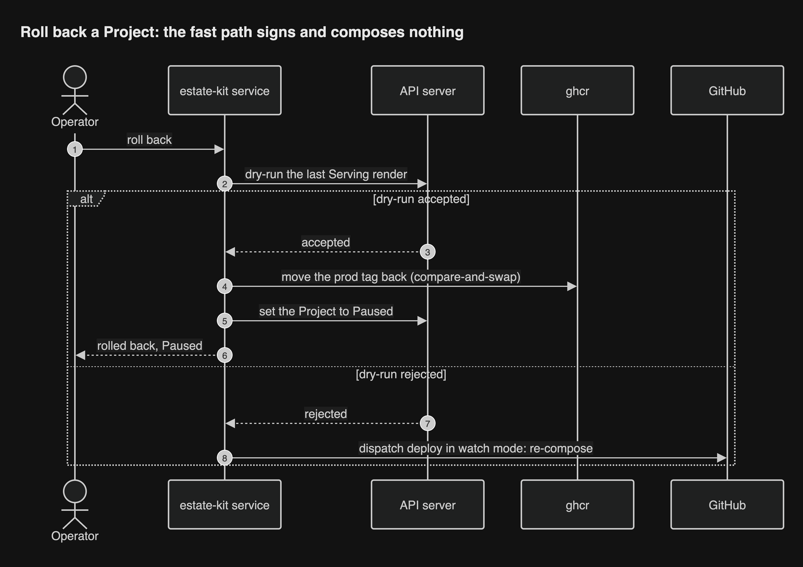
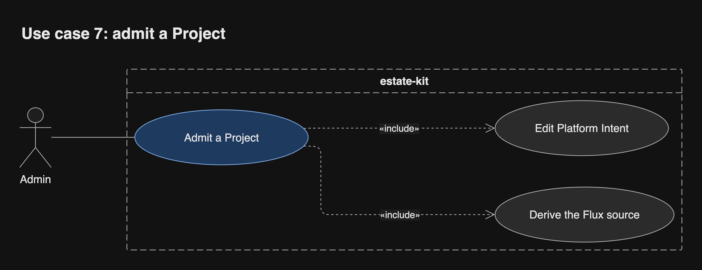

# Operating the estate

Operators act through the UI. Every rollout they start still shows up as a
deploy run and a Deployment in the Project's own repository.

## Rollouts no Project run started

A Platform Intent change, the nightly recompose or a Rollback from the UI: the
service dispatches the Project's `deploy` workflow in watch mode, with a run
name that says why (for example "Deploy notes: Platform Intent changed").
Missed triggers heal on a timer that scans the registry for fragments newer
than the last composition.

## UC-5 Pause or resume a Project

An Operator pauses a Project in the UI. The service records it in the Project's
cluster object and stops moving its tag until the Operator resumes. Outcome:
Flux keeps serving the current render.

## UC-6 Roll back a Project

An Operator rolls a Project back. The fast path signs nothing and composes
nothing ([review](../research/review/README.md) D7): the service dry-runs the last Serving render against today's
cluster, moves `render/
:prod` back to it with compare-and-swap, and sets the
Project to Paused, so no new release moves the tag until the Operator resumes.
Only if that dry-run fails does the service re-compose at the earlier fragment
and dispatch the deploy run in watch mode. Signatures are kept exactly as long
as their renders, so every render that ever served can serve again. Outcome:
the previous render serves within five minutes, even with Vault down.

## UC-7 Admit a Project

An Admin merges a Platform Intent change that admits a Project's
`repository_id`. The service derives the Project's Flux source into the
platform render. Outcome: the Project's CI may deploy from then on.

## UC-8 Pull and apply a render

Flux sees `render/
:prod` point at a new digest, verifies the signature, then
applies and prunes. Outcome: the cluster holds the new render; the traffic
switch is UC-9.

## UC-9 Gate a traffic switch

Flagger asks the Release Gate whether to promote. The service answers from
cluster state alone, yes only when every member of the Release Unit is
healthy. Flagger cannot authenticate the call, so the gate reads and never
writes. Outcome: traffic switches
together, or the release is Held.

## States of a Project

A Project's state decides whether the service may move its tag. A Project
with no cluster object at all is treated as Paused, so a lost object fails
safe.

## When something underneath fails

| What fails | What keeps working | How it comes back |
| --- | --- | --- |
| The service pod | Flux serves the last tags | Recreate starts one pod; it reconciles unfinished rollouts from ghcr and Flux status (D9) |
| Vault | Serving, and rollback | Auto-unseal through a cloud KMS; a VaultSealed alert (D6); the offline recovery key for break-glass (D10) |
| ghcr or GitHub | Serving, until a pod moves to a node without the image | Deploys fail loudly and resume when it returns |
| The control-plane node | Workloads keep running | Rebuild with nixos-anywhere, restore the k3s datastore from its off-provider backup, restore Vault from its snapshot (D5) |
| The service, Vault and GitHub together | Serving | The break-glass runbook: `flux suspend`, or an OCIRepository pinned to a digest, by hand ([#39](https://github.com/JorisJonkers-dev/estate-kit/issues/39)) |

Every row is answered in the [review](../research/review/README.md), decisions D5 to D10.
