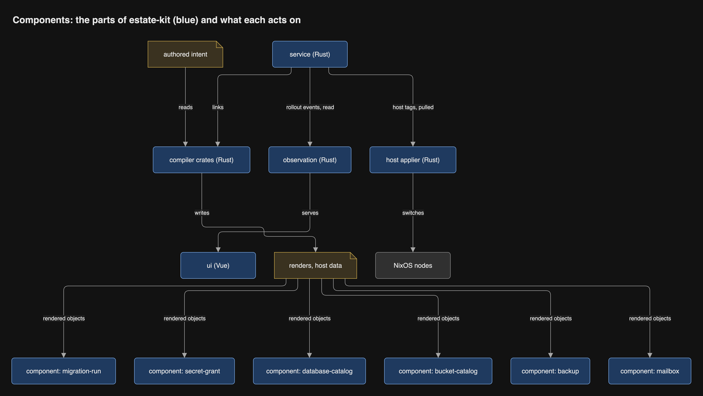

# Overview

estate-kit is a fresh repository that replaces deploy-kit, delivery and
estate-dashboard. Every program in it is Rust, in one Cargo workspace; only
the UI stays Vue ([record 13](../decisions/0013-every-program-is-rust.md)).
The compiler implements deploy-kit's 1.0 specification, released on
2026-10-27 ([record 67](../decisions/0067-the-compiler-is-written-to-the-1-0-contract.md)),
and the in-cluster service links it to compose the estate. Flux stays the one
applier, locked down per Project, and each Project's state stays with the
Project. The service runs in shadow beside production, and replaces the old
stack Project by Project. This reverses the order the
[design review](../research/review/README.md) of 2026-10-22 set (D1): the
model rewrite it waited for has shipped, and the TypeScript compiler is not
carried into estate-kit.

## At a glance

A Project's CI asks the service to deploy. The service composes, dry-runs,
signs and moves the Project's `prod` tag. Flux pulls the tag and applies it.

## The parts of estate-kit

Three programs and six components, all Rust, in one repository at one
version. The compiler is the only part that knows the model; the others act on
what it renders. The [high-level design](high-level-design.md) shows the
whole system in diagrams, and [The Rust workspace](rust-workspace.md) how it
is organised.

## System context (C4 level 1)

Everything estate-kit talks to, and nothing else. An integration not on this
diagram does not exist.

## Containers (C4 level 2)

Every deployable unit and the protocol on each connection.

## Evaluation of what is replaced

The TypeScript code is healthy. Its risk is the toolchain around it, and the
EMF implementation has nothing to port.

| | TypeScript compiler (`src/`) | EMF implementation (`emf/`) |
| --- | --- | --- |
| Size | At 1.0.1: about 19,500 source lines and 36,600 test lines | 536 model and Java files |
| Runtime dependencies | 2 (`yaml`, `zod`) | Eclipse, Maven and Tycho, JDK 21 |
| Quality bar | Coverage about 99.5%, mutation break score 100% | Parity with the oracle files |
| Weak points | About 230 npm packages in the dev and CI tree; types erased at runtime; Node startup; no single binary | Exists only for the course; deleted after the 2026-10-30 hand-in |
| Carried forward | Behaviour, through the oracle files | The parity contract |

## Order of work

The old repositories serve production and keep evolving until the last switch.
The full plan, with budgets, exits and fallbacks per phase, is
[`plan/port.md`](../plan/port.md), tracked as
[epic #9](https://github.com/JorisJonkers-dev/estate-kit/issues/9).

1. **Spikes** that settle the open mechanisms: ghcr credentials, OIDC claims,
   Vault auto-unseal, the dry-run identity, datastore restore, boot
   assessment, signature replay, and the compiler as one binary.
2. **Found estate-kit** after the 2026-10-30 hand-in and the deletion of
   `emf/`. Import deploy-kit, delivery and estate-dashboard with history. Write
   the records and `docs/lessons.md`.
3. **Walking skeleton.** The Rust workspace with every gate, and `minimal`
   rendered end to end through the Rust compiler and the service into a shadow
   tag.
4. **Deploy path.** Flux lockdown, the dry-run identity, split signing keys,
   tag moves, provenance and the fast rollback.
5. **Recovery on today's estate.** Datastore backups, Vault auto-unseal, Nix
   key custody. These do not wait for estate-kit.
6. **Hosts.** Host data, the host applier, VM tests, break-glass on deploy-rs.
7. **Shadow and switch.** Shadow tags beside production, then a switch Project
   by Project, then the dashboard, then archiving.
8. **The model.** The rest of the 1.0 specification and its additive
   releases, chapter by chapter, met against deploy-kit's oracles.

## Risks and open questions

- **Effort.** A few maintainer hours a week. The host applier, built now by the
  maintainer's choice (review D2), is the largest bespoke part of the plan.
- **Toolchains.** Rust for every program, npm for the UI build only, Nix for
  the hosts, and Python for this repository's documentation checks.
- **The port is the long pole.** About 19,500 lines of TypeScript and 8,300 of
  Go are rewritten. The language-neutral oracles (corpus verdicts and diagnostic sets, refusal
  codes and paths, expected models) bound the compiler's work; characterization
  tests bound the services'.
- **The Rust YAML stack is young.** The spanned reader is chosen by a spike;
  the canonical emitter is our own code, about a page of specification.
- **Vault on the deploy path.** If Vault is down, nothing new is signed; Flux
  keeps serving the last tags, a rollback still works without Vault, and the
  offline recovery key can sign in a break-glass.
- **The single control plane.** Its loss stops the API server until the
  datastore is restored from its off-provider backup.
- **No PR-reviewable pin.** A tag move leaves no commit; the audit trail is the
  GitHub Deployments and the event log.
- **Open:** the shadow's exit rule, fixed in
  [#50](https://github.com/JorisJonkers-dev/estate-kit/issues/50) before the
  shadow starts.
- **Open:** the name and kind (CRD or ConfigMap) of the per-Project object for
  Pause and Rollback.
- **Open:** how a Mailbox is shared beyond its own Project, if ever.
