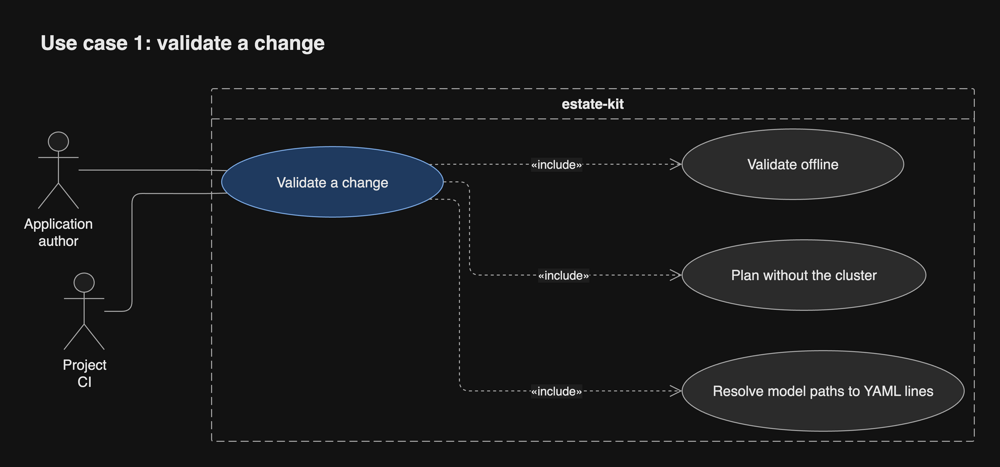
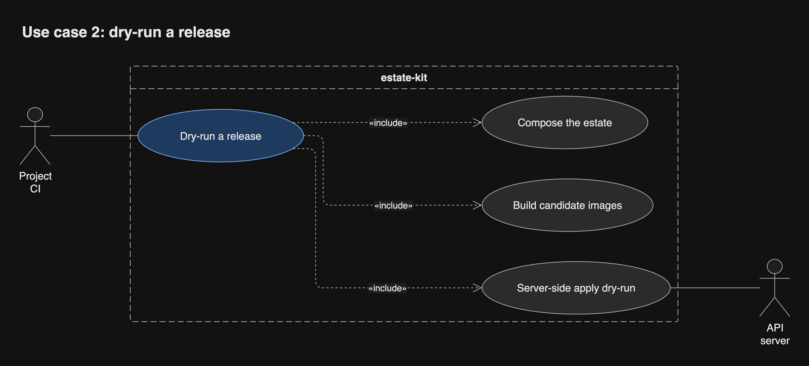
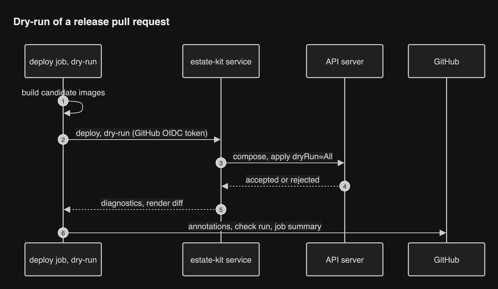
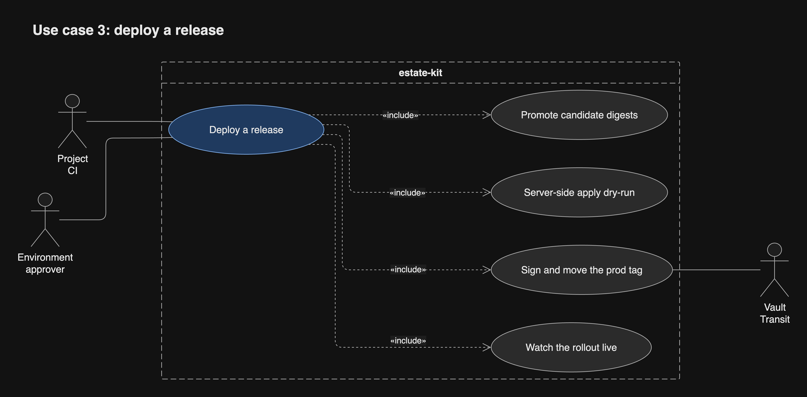
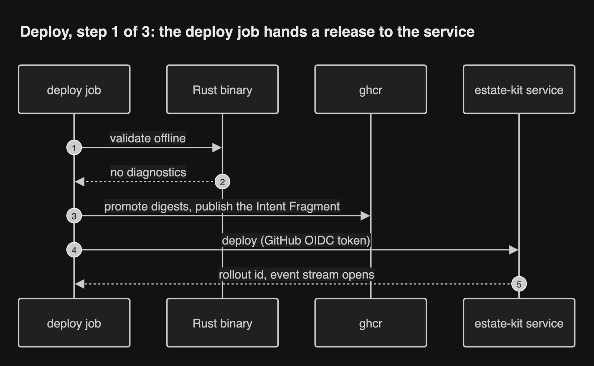
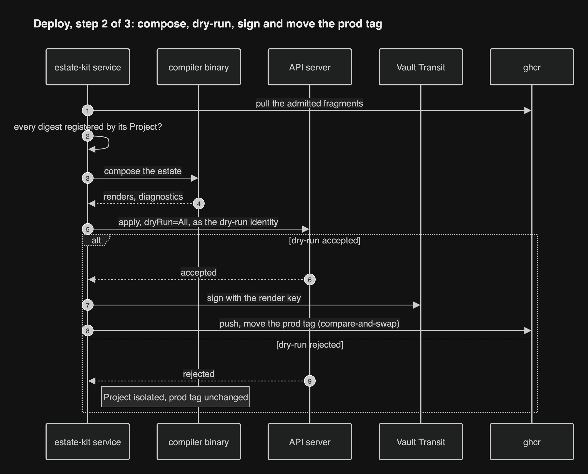
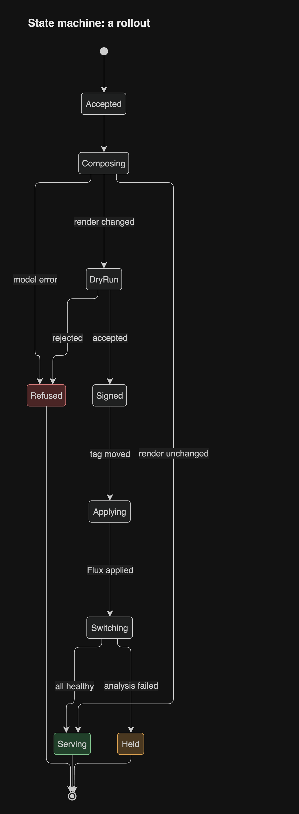
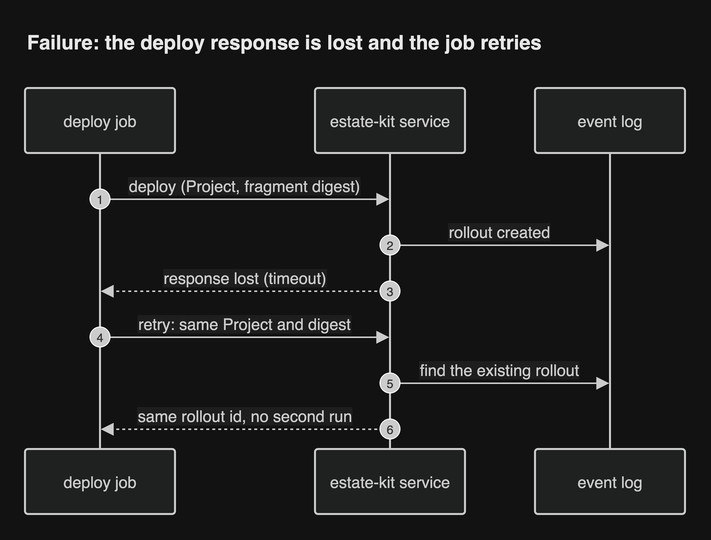

# Releasing a Project

Every rollout is a GitHub Actions run in the Project's repository. The service
does all the work, and the deploy job streams it live, from validation to the
last Flagger promotion.

## Names

A Project has two workflows, `validate` and `deploy`. A dry-run is `deploy`
with `dry-run: true`, identical except that nothing is signed, tagged or
applied. Composition is the service's estate-wide step. It appears only as a
log step, "Composing the estate", and never as the name of a workflow, job or
check.

## What a dry-run is

The service composes, then sends every changed object to the live API server
with `dryRun=All` under Flux's field manager, as its own identity. A
ValidatingAdmissionPolicy refuses that identity any request without `dryRun`,
so the dry-run identity cannot write ([review](../research/review/README.md) D4). Nothing persists. A dry-run
catches admission webhooks, CRD schemas, immutable fields, quota and field
conflicts, as well as every model error. It must pass twice: on the
release-please PR, and again right before any tag moves.

## The three runs

| Trigger | Workflow | Check | What it does |
| --- | --- | --- | --- |
| Ordinary pull request | `validate` | `estate-kit / validate` | Offline checks, then a plan from the service: cross-Project errors and the render diff |
| Release-please pull request | `deploy`, `dry-run: true` | `estate-kit / deploy (dry-run)`, required | A build job builds candidate images by digest; a separate job registers those digests with the service and runs the full dry-run against the cluster; no Deployment record |
| Release published | `deploy`, environment `production` | `estate-kit / deploy` | Promotes the candidate digests; the service checks every digest was registered by this Project (D8), dry-runs again, signs with the render signing key, moves `render/
:prod` by read, verify, write under the writer Lease, and streams the rollout |

Cancelling a deploy job only detaches it; the rollout continues. Stopping a
rollout is a Pause or a Rollback. A dropped stream resumes from its last event.

## UC-1 Validate a change

An Application author opens or updates an ordinary pull request. Outcome: the
check `estate-kit / validate`, errors on their YAML lines, and the render diff
in the summary.

## UC-2 Dry-run a release

Release-please opens or updates its pull request. Outcome: the required check
`estate-kit / deploy (dry-run)`; a failure blocks the merge.

## UC-3 Deploy a release

A release is published and the production environment's approver allows it.
Outcome: the Deployment shows Serving, Held or Refused.

**Step 1, admission.** The job validates, publishes the fragment and opens the
stream.

**Step 2, dry-run and signing.** Nothing is signed unless the API server
accepts the dry-run. A render whose digest is unchanged is not published
again. The tag is moved with a machine account's token, synced by the Vault Secrets Operator into a Kubernetes Secret the service mounts, because ghcr
refuses GitHub App tokens (D3), and only by the pod holding the writer Lease
(D9).

**Step 3, apply and switch.** Flux applies; the Release Gate holds traffic
until every member is healthy.

## UC-4 Watch the rollout live

An Application author follows a rollout from the deploy run's log or the UI.
Outcome: they see where it is and why it stopped.

## States of a rollout

A rollout ends in exactly one of Serving, Held or Refused.

## Failure paths

**A deploy call is retried.** A deploy call is idempotent on (project, fragment
digest): a retry after a lost response returns the same rollout, and no second
rollout starts.

**The stream drops.** The stream is at-least-once. The job resumes after the
last sequence number it saw and drops any duplicates.

**The dry-run is rejected.** The Project is isolated, its tag does not move,
and the job fails with the error on its YAML line.

**Vault is sealed or down.** Nothing new is signed, so deploys fail loudly with
a problem that names Vault, and resume once it returns. Vault unseals itself
through a cloud KMS after a restart, and a VaultSealed alert fires meanwhile
([review](../research/review/README.md) D6). Serving is unaffected, and a rollback still works, because it signs
nothing.
