# Releasing a Project

Every rollout is a GitHub Actions run in the Project's repository. Delivery
does all the work, and the deploy job streams it live, from validation to the
last Flagger promotion.

## Names

A Project has two workflows, `validate` and `deploy`. A dry-run is `deploy`
with `dry-run: true`, identical except that nothing is signed, tagged or
applied. Composition is Delivery's estate-wide step. It appears only as a
log step, "Composing the estate", and never as the name of a workflow, job or
check. A separate dry-run workflow or a compose workflow was rejected: Delivery owns composition, so the Project's workflows need not name it.
A dry-run records no Deployment, and a dry-run environment was rejected, so
the production history holds real deploys only.

The deploy job owns the Deployment and streams the rollout, so every rollout
is a run with its approval gates. Deployments created by Delivery were
rejected.

## What a dry-run is

Delivery composes, then sends every changed object to the live API server
with `dryRun=All` under Flux's field manager, as its own identity. A
ValidatingAdmissionPolicy refuses that identity any request without `dryRun`,
so the dry-run identity cannot write ([review](../research/review/README.md) D4). Nothing persists. A dry-run
catches admission webhooks, CRD schemas, immutable fields, quota and field
conflicts, as well as every model error. It must pass twice: on the
release-please PR, and again right before any tag moves.

## The three runs

| Trigger | Workflow | Check | What it does |
| --- | --- | --- | --- |
| Ordinary pull request | `validate` | `estate-kit / validate` | Offline checks, then a plan from Delivery: cross-Project errors and the render diff |
| Release-please pull request | `deploy`, `dry-run: true` | `estate-kit / deploy (dry-run)`, required | A build job builds candidate images by digest; a separate job registers those digests with Delivery and runs the full dry-run against the cluster; no Deployment record |
| Release published | `deploy`, environment `production` | `estate-kit / deploy` | Promotes the candidate digests; Delivery checks every digest was registered by this Project (D8), dry-runs again, signs with the render signing key, moves `render/
:prod` by read, verify, write under the writer Lease, and streams the rollout |

Cancelling a deploy job only detaches it; the rollout continues. Stopping a
rollout is a Pause or a Rollback, in one Environment: every Pause, Resume and
Rollback command names its Environment (`--env`, required in every
Environment, an omitted one is refused), and a Rollback targets a digest that
reached Serving there
([record 118](../decisions/0118-a-rollback-is-per-environment-and-targets-a-digest-that-reached-serving.md)).
A dropped stream resumes from its last event.

A published release deploys to staging with the same digests, and the staging
Rollout gates what reaches production
([record 75](../decisions/0075-three-environments-run-in-the-one-cluster.md)):
a staging Rollout that ended Refused, Held on a failed Analysis verdict or
Observation lost blocks the same release's `production` approval until the
maintainer confirms the staging Application served it, and a staging Rollout
Held on an inconclusive verdict — a Project too quiet to gather a sample —
blocks nothing
([record 132](../decisions/0132-a-staging-rollout-that-ended-refused-held-on-a-failed-verdict-or-observation-lost-blocks-its-release-s-production-approval-and-a-quiet-held-does-not.md)).

## UC-1 Validate a change

An Application author opens or updates an ordinary pull request. Outcome: the
check `estate-kit / validate`, errors on their YAML lines, and the render diff
in the summary.

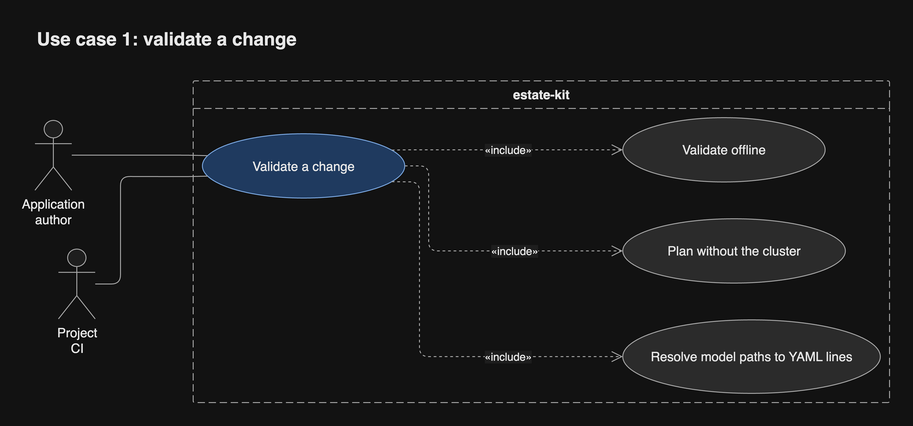

## UC-2 Dry-run a release

Release-please opens or updates its pull request. Outcome: the required check
`estate-kit / deploy (dry-run)`; a failure blocks the merge.

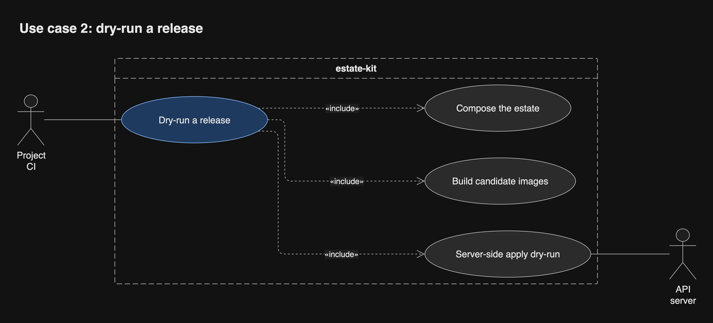

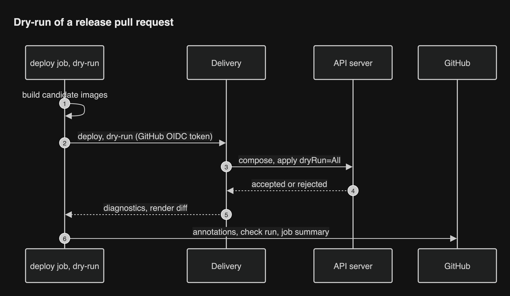

## UC-3 Deploy a release

A release is published and the production environment's approver allows it.
Outcome: the Deployment shows the Operation's outcome: Serving, Held, Refused,
Superseded or Observation lost.

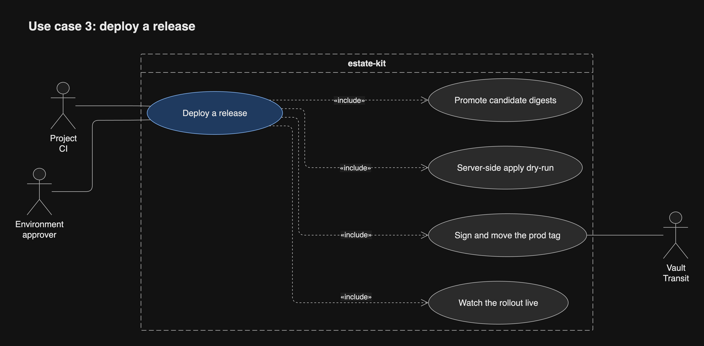

**Step 1, admission.** The job validates, publishes the fragment and opens the
stream.

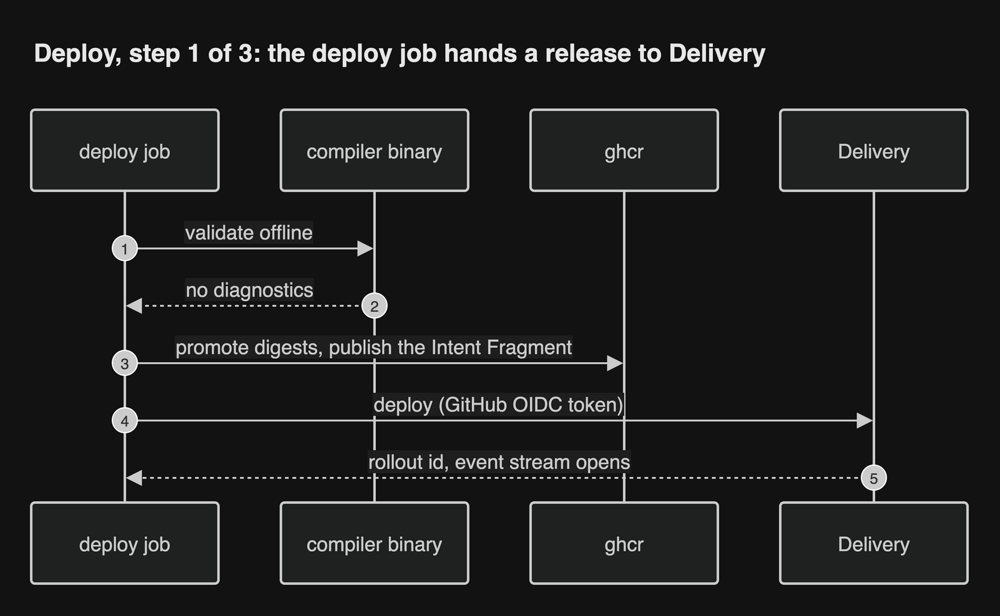

**Step 2, dry-run and signing.** Nothing is signed unless the API server
accepts the dry-run. A render whose digest is unchanged is not published
again. The tag is moved with a machine account's token, synced by the Vault Secrets Operator into a Kubernetes Secret Delivery mounts, because ghcr
refuses GitHub App tokens (D3), and only by the pod holding the writer Lease
(D9).

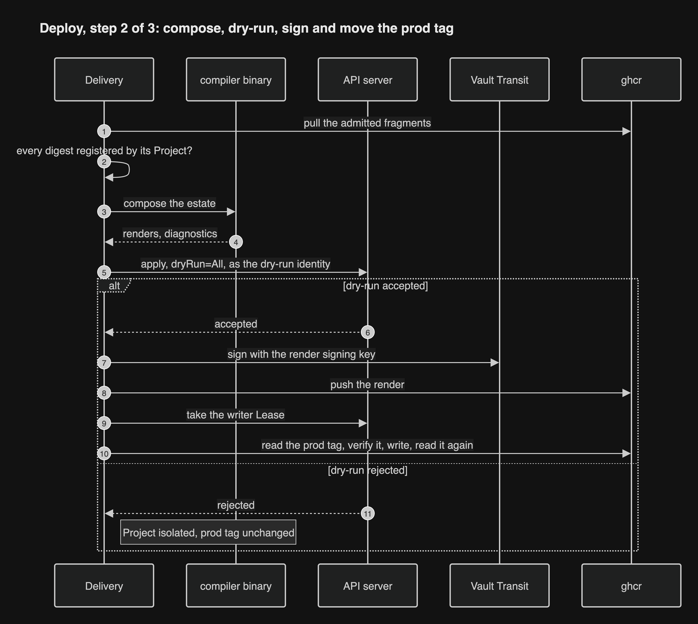

**Step 3, apply and switch.** Flux applies; the Release Gate holds traffic
until every member is healthy.

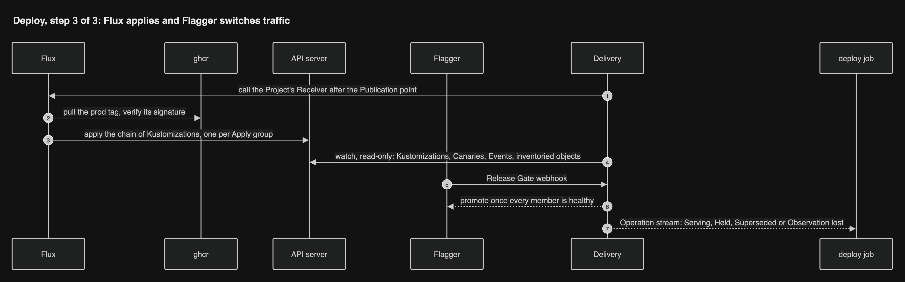

## UC-4 Watch the rollout live

An Application author follows a rollout from the deploy run's log or the UI.
Outcome: they see where it is and why it stopped.

## The Operation

A deploy is one Operation of one Project to one Environment
([record 96](../decisions/0096-a-deploy-is-an-operation-that-ends-serving-held-refused-superseded-or-observation-lost.md)).
The caller mints its Operation id (the reusable deploy workflow mints one per
run attempt), and Delivery returns it with the URL of its stream. Every
Rollout event carries it, and the source revision and render digest are bound
to it. A retry with the same id and the same fragment digest returns the same
Operation; the same id with another digest is refused; identical content under
a new id is a new Operation. Losing the caller never cancels an Operation;
`estate-kit watch <operation>` reattaches.

## The Receiver call and the Kustomization chain

After the Publication point, Delivery calls the Project's Flux Receiver, so
Flux fetches the new render at once; the reconcile interval stays as the
fallback if the call is lost
([record 94](../decisions/0094-flux-stays-the-one-applier-observed-closely-and-an-estate-kit-applier-waits-for-a-review-trigger.md)).
Each Apply group is its own Flux Kustomization, joined by `dependsOn` and
health checks, under the Project's one service account
([record 95](../decisions/0095-a-project-renders-as-a-chain-of-flux-kustomizations-one-per-apply-group.md)).
Each group prunes what it no longer names, except the prune-protected kinds,
rendered CRDs among them: a render that stops naming a CRD deletes nothing
([record 105](../decisions/0105-removal-is-a-retire-lifecycle-with-durable-retirement-tombstones-and-declared-moves-and-prune-protected-kinds-never-prune.md),
[record 119](../decisions/0119-a-rendered-crd-is-prune-protected-and-retirement-tombstones-survive-a-crd-drop.md)).
Delivery watches, read-only, the Project's Kustomizations, OCIRepository and
Canary objects, Events in `flux-system` and the Project's namespaces, and
every object in each step's inventory. It computes each object's health itself
by the kstatus rules and never takes Flux's summary as the truth.

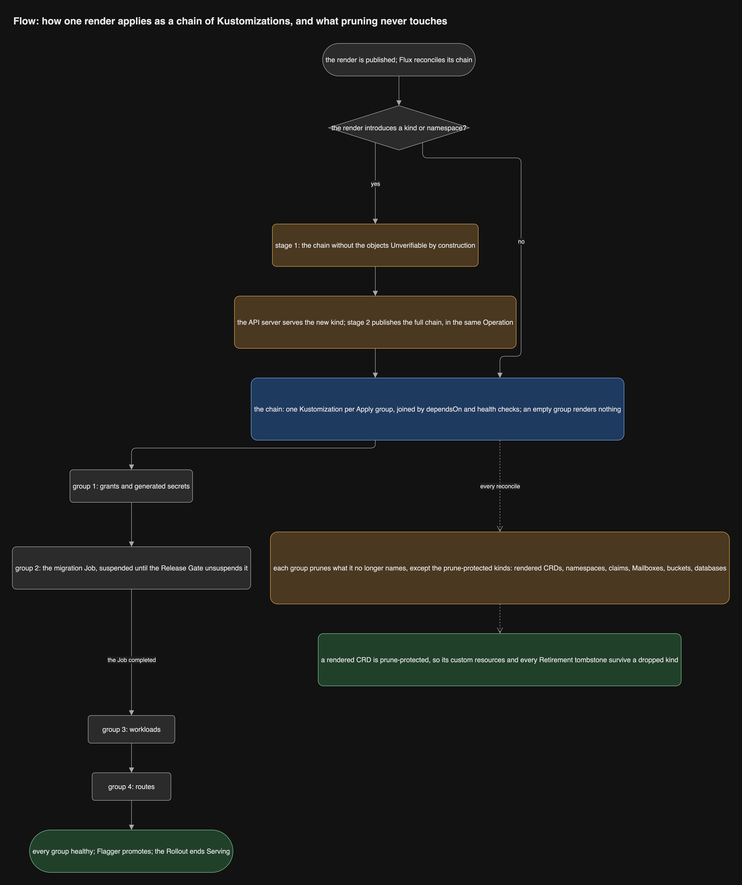

## The Publication point and two-stage publication

The Publication point is the move of the Environment tag by read, verify,
write and read again
([record 97](../decisions/0097-the-publication-point-is-named-and-tested-and-a-render-that-introduces-a-kind-is-published-in-two-stages.md)).
No other step makes a render visible to Flux. Code tests an interruption on
each side of it. Interrupted before it, a render may be pushed and signed but
no tag names it; the restarted Delivery finds no change Flux can read and
decides again from the inputs. Interrupted after it, the restarted Delivery
observes the tag, follows the Rollout by observation, and never publishes
again on the log's word.

A render that introduces a kind or a namespace is published in two stages.
The plan names each object that is Unverifiable by construction: one whose
kind or namespace the API server does not yet serve because this render brings
it. The first stage is the full render without those objects, dry-run and
published as usual. Once Flux has applied it and the API server serves the new
kinds and namespaces, the full render is dry-run again and published as the
second stage, in the same Operation.

## The five outcomes

An Operation ends in exactly one of five outcomes, and `estate-kit watch` exits
with that outcome's code
([record 96](../decisions/0096-a-deploy-is-an-operation-that-ends-serving-held-refused-superseded-or-observation-lost.md)):

| Outcome | When | Exit |
| --- | --- | --- |
| Serving | The intended digest is the applied revision of every Apply group's Kustomization, every inventoried object is healthy by the kstatus rules, that digest's migration has completed, and every Canary has promoted that digest | 0 |
| Held | The render was published, and a step, object, migration or analysis failed, so the old version keeps serving; with a reason and a deadline | 10 |
| Refused | Delivery stopped it before the Publication point: admission, digest registration, Pause, composition or dry-run; nothing changed | 11 |
| Superseded | A newer Operation for the same Project and Environment was composed in its place or published over it before it ended | 12 |
| Observation lost | Delivery has had no observation of Flux or Flagger for 10 minutes, so it cannot say how the Rollout ended; the Rollout goes on and may still reach Serving | 13 |

Exit 1 means the watch itself failed (it could not authenticate or reach
Delivery) and says nothing of the Operation; exit 2 is a usage error.

Two bounds apply. When Flux has not picked a published render up after
30 seconds, the stream says so, and the Operation goes on. When Delivery has
had no observation at all for 10 minutes, the Operation ends Observation lost.
Separately, Delivery alerts when the applied revision trails the latest
published one for 1 hour, as the low-attention defaults of
[record 86](../decisions/0086-the-estate-states-its-defaults-for-a-low-attention-week.md) state.

## Roll-forward

A Rollback reads the migration state before it dry-runs. If the current state
does not meet the target render's migration preconditions, the Rollback is
refused with a code that names the migration that blocks it, and nothing is
published
([record 101](../decisions/0101-a-rollout-rolls-forward-when-rolling-back-would-run-a-migration-backwards.md)).
A Roll-forward is then the way out: `estate-kit roll-forward <project> --env
<env>` deploys a fixed fragment the Project has released, as a new Operation
on the full deploy path, with both dry-runs and the Publication point. Its
failsafe is to hold at the current version, never to revert.

## Analysis verdicts

Analysis is a pure function in its own domain crate, `analysis`
([record 102](../decisions/0102-analysis-is-a-pure-verdict-function-and-an-inconclusive-verdict-holds.md)):
from one check's declaration and the samples for its window, it returns an
Analysis verdict, pass, fail or inconclusive, with a reason. Too little
traffic and missing telemetry are inconclusive, never pass and never fail.

The Release Gate turns verdicts into Flagger's answers. Every check passing
lets it answer yes. A fail sets off the plan's declared failsafe; by default
the gate answers yes on the rollback hook, so Flagger reverts traffic, the old
version keeps serving, and the Operation ends Held with the check's reason. An
inconclusive verdict holds: the gate answers no on the confirm hooks, which
pause the canary, and never gives it as an error on a hook that counts toward
a rollback. Inconclusive never promotes, and a Rollout held on it waits out
its plan's deadline — 24 hours unless the Project states another — then ends
Held with the Environment tag still naming the held render, with the
maintainer paged and nothing promoted by itself; an Operator promotes or rolls
back, and a later render starts a new Rollout and cancels the pending
deadline. Time never promotes it
([record 131](../decisions/0131-a-held-rollout-on-a-quiet-project-ends-at-its-deadline-with-the-tag-unchanged.md)).

## States of a rollout

A Rollout ends in exactly one of Serving, Held, Refused, Replaced or Observation lost. Superseded is never a Rollout end: a newer Operation for the same Project and Environment that closes a
Rollout which had begun ends it Replaced, and that older Operation ends
Superseded, an Operation end only, one of the five outcomes whose exit codes
the table holds
([record 96](../decisions/0096-a-deploy-is-an-operation-that-ends-serving-held-refused-superseded-or-observation-lost.md),
[record 130](../decisions/0130-a-rollout-ends-serving-held-refused-replaced-or-observation-lost-and-superseded-is-an-operation-end-only.md)).
Observation lost means Delivery stops seeing Flux and Flagger; the Rollout
then goes on, and may still reach Serving. A Held Rollout ends at its
deadline — 24 hours unless the Project states another — with the Environment
tag still naming the held render: nothing is promoted by itself, an Operator
promotes or rolls back, and a later render starts a new Rollout and cancels
the pending deadline
([record 131](../decisions/0131-a-held-rollout-on-a-quiet-project-ends-at-its-deadline-with-the-tag-unchanged.md)).

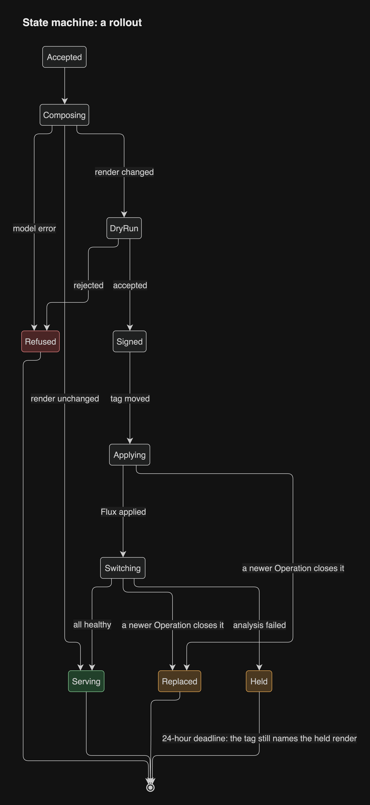

## Failure paths

**A deploy call is retried.** A deploy call is idempotent on its Operation id:
a retry after a lost response, with the same id and the same fragment digest,
returns the same Operation, and no second Rollout starts. The same content
under a new id is a new Operation
([record 96](../decisions/0096-a-deploy-is-an-operation-that-ends-serving-held-refused-superseded-or-observation-lost.md)).

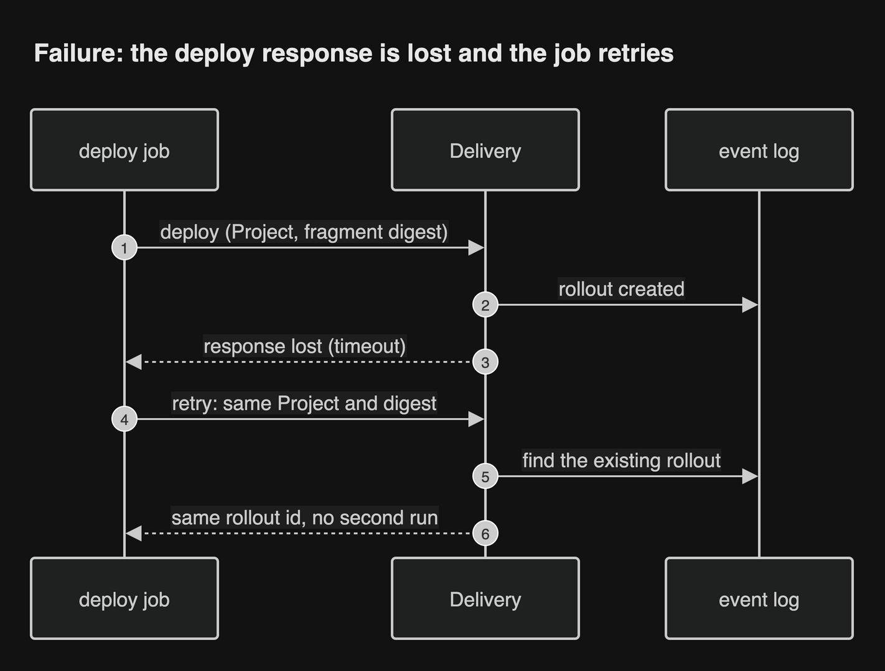

**The stream drops.** The stream is at-least-once. The job resumes after the
last sequence number it saw and drops any duplicates.

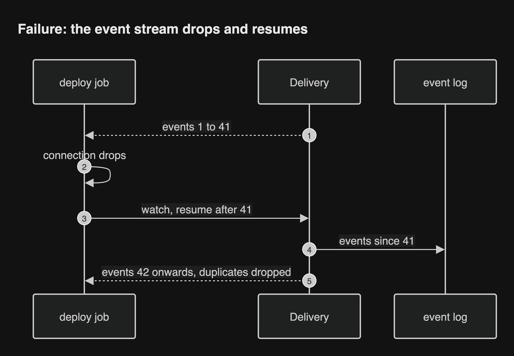

**The dry-run is rejected.** The Project is isolated, its tag does not move,
and the job fails with the error on its YAML line.

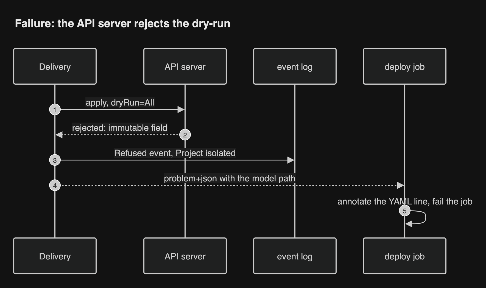

**Vault is sealed or down.** Nothing new is signed, so deploys fail loudly with
a problem that names Vault, and resume once it returns. Vault unseals itself
through a cloud KMS after a restart, and a VaultSealed alert fires meanwhile
([review](../research/review/README.md) D6). Serving is unaffected, and a rollback still works, because it signs
nothing.
