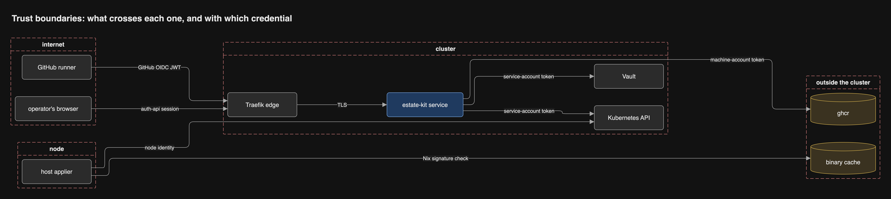

# Security

One threat table per trust boundary, and one authorization matrix that tests
enforce. Everything here is Proposed until the maintainer accepts it. The
[review](../research/review/README.md) of 2026-10-22 rewrote the rows marked with its decisions.

## Trust boundaries

Vault, the edge, the service and the API server sit inside the cluster.
GitHub, the browser, ghcr and the binary cache sit outside it, and every
crossing carries a verified identity.

## Threats per boundary (STRIDE)

| Boundary | Threat | Mitigation |
| --- | --- | --- |
| Runner to edge | Spoofing: a forged deploy call, or a pull_request_target run posing as a release | GitHub OIDC JWT checked against a claim policy: `repository_id` and owner id admitted, `job_workflow_sha` pinned, `event_name` allowlisted, `ref_type` tag, a GitHub-hosted runner, the production environment; never `sub` (D8) |
| Runner to edge | Tampering: a fragment that names another Project's image | Every digest must have been registered by the Project's own build job, or be on the third-party allowlist in Platform Intent (D8) |
| Runner to edge | Tampering: an altered fragment | Fragments are signed and named by digest |
| Runner to edge | Repudiation: who deployed what | The event log records the token's claims; the GitHub Deployment records the run |
| Browser to edge | Elevation: an operator action by a viewer | Roles from auth-api groups; every route has a row in the matrix below |
| Browser to edge | Cross-site request forgery | Same-origin UI, SameSite cookies |
| Service to Vault | Elevation: the service signs anything | The Transit keys may only sign; the service signs only after an accepted dry-run, and a test proves it. Renders and host tags have separate keys (D10) |
| Service to Vault | Denial: Vault is sealed or lost | Auto-unseal through a cloud KMS and a VaultSealed alert (D6); rollback needs no signing (D7); an offline recovery key every verifier trusts (D10) |
| Service to Vault | Disclosure: the signing key leaks | The key is not exportable |
| Service to ghcr | Tampering: someone else moves a tag | Flux and the host appliers verify the signature; the tag is moved by a machine account's PAT kept in Vault, with write only on the render and host packages and a check that fails on any other grant (D3) |
| Service to API | Elevation: the dry-run identity writes | A ValidatingAdmissionPolicy refuses every request from the service's identity unless `dryRun` is set (D4) |
| Flux to API | Elevation: a signed render writes outside its Project | Flux lockdown; each Kustomization runs as its Project's service account in its target namespace; Pod Security and a digest-only image policy per Project (D4) |
| Applier to cache | Tampering: a malicious closure | Nix signature checked against one trusted public key, whose private key is an environment-scoped secret limited to main with a reviewer (D10); the host tag is signed with the host key and binds the closure's store path |
| Applier to API | Elevation: a node evicts other nodes' pods | Each node has its own credential, and a ValidatingAdmissionPolicy limits its evictions to pods whose `spec.nodeName` is its own node (D2); RBAC alone cannot |
| Applier to API | Denial: a Lease held forever | The Lease has a time-to-live |
| Break-glass | Elevation: a hand-made switch | Needs local root on the node and a signed generation |

## Authorization matrix

Every route is one row here, and a test fails on a route without one.

| Action | Project CI (release) | Project CI (PR) | Estate CI | Viewer | Operator | Admin | Flagger | Host applier |
| --- | --- | --- | --- | --- | --- | --- | --- | --- |
| Deploy a release | own Project | no | platform | no | no | no | no | no |
| Plan or dry-run | own Project | own Project | platform | no | no | no | no | no |
| Watch a rollout | own rollout | own run | own rollout | yes | yes | yes | no | no |
| Pause, resume, roll back | no | no | no | no | yes | yes | no | no |
| Change admissions | no | no | through Platform Intent | no | no | yes | no | no |
| Answer a Release Gate webhook (read-only, from cluster state) | no | no | no | no | no | no | yes | no |
| Register built image digests | own Project | no | platform | no | no | no | no | no |
| Read its host tag | no | no | no | no | no | no | no | own node |
| Read estate status | no | no | no | yes | yes | yes | no | no |
