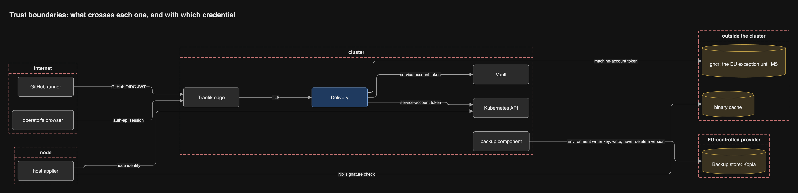
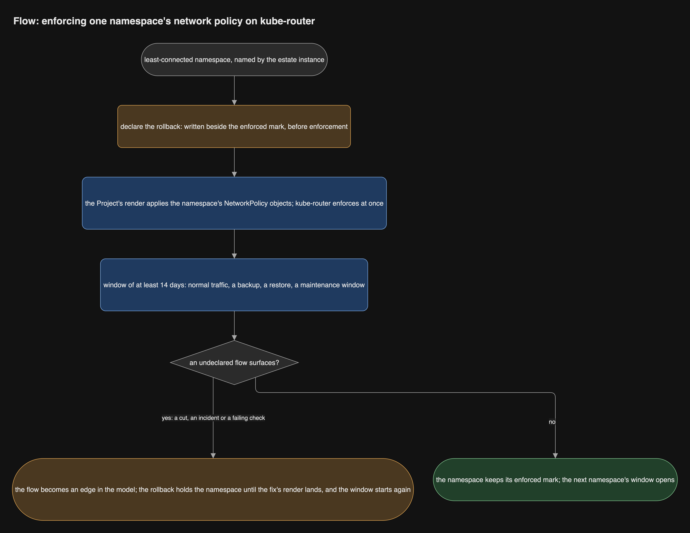

# Security

One threat table per trust boundary, and one authorization matrix that tests
enforce. A row binds through the record it cites; a row that cites none, or
only a Proposed record, binds nothing yet. The
[review](../research/review/README.md) of 2026-10-22 rewrote the rows marked with its decisions.

## Trust boundaries

Vault, the edge, Delivery and the API server sit inside the cluster.
GitHub, the browser, ghcr and the binary cache sit outside it, and every
crossing carries a verified identity.

## Where estate data is kept

Every store of estate data runs on an EU-controlled provider or on owned
hardware
([record 116](../decisions/0116-every-store-of-estate-data-runs-on-an-eu-controlled-provider-or-on-owned-hardware.md)).
A store is any place the estate keeps its data: backups, the WAL archive, the
render registry and the binary cache. An EU-controlled provider is incorporated
in an EU member state and is not controlled by a company outside the EU; an EU
region of a provider controlled from elsewhere does not count. Owned hardware is
a machine the maintainer owns. The rule protects the estate's data against US
sanctions.

ghcr is the one named exception: it keeps renders and host tags until milestone
M5. No other exception exists without a record. The forge, CI and DNS move off
US providers over time, with no deadline, and Project images and fragments move
with the forge and CI.

Platform Intent lists each store with its provider, and the provider's Provider
facts state its jurisdiction: EU-controlled, owned, or other. A new store gets
its entry before it holds data. The Provider register lint fails a store whose
provider is neither EU-controlled nor owned, other than ghcr, and fails a store
in the copy inventory or a Recovery class that has no entry.

## Threats per boundary (STRIDE)

| Boundary | Threat | Mitigation |
| --- | --- | --- |
| Runner to edge | Spoofing: a forged deploy call, or a pull_request_target run posing as a release | GitHub OIDC JWT checked against a claim policy: `repository_id` and owner id admitted, `job_workflow_sha` pinned, `event_name` allowlisted, `ref_type` tag, a GitHub-hosted runner, the production environment; never `sub` (D8) |
| Runner to edge | Tampering: a fragment that names another Project's image | Every digest must have been registered by the Project's own build job, or be on the third-party allowlist in Platform Intent (D8) |
| Runner to edge | Tampering: an altered fragment | Fragments are signed and named by digest |
| Runner to edge | Repudiation: who deployed what | The event log records the token's claims; the GitHub Deployment records the run |
| Forge to edge | Spoofing: a caller from an issuer whose tokens cannot state the repository's stable id, the pinned workflow's commit and the event | The issuer is not admitted, and there is no fallback to a long-lived token ([record 8](../decisions/0008-an-image-digest-is-sealed-into-the-fragment-and-registered-by-its-build.md)) |
| Browser to edge | Elevation: an operator action by a viewer | Roles from auth-api groups; every route has a row in the matrix below |
| Browser to edge | Cross-site request forgery | Same-origin UI, SameSite cookies |
| Delivery to Vault | Elevation: Delivery signs anything | The Transit keys may only sign; Delivery signs only after an accepted dry-run, and a test proves it. Renders and host tags have separate keys (D10) |
| Delivery to Vault | Denial: Vault is sealed or lost | Auto-unseal through a cloud KMS and a VaultSealed alert (D6; assumed from fleet-infra, [record 59](../decisions/0059-vault-unseal-and-datastore-backup-are-assumed-from-fleet-infra.md)); rollback needs no signing (D7); an offline recovery key every verifier trusts (D10) |
| Delivery to Vault | Disclosure: the signing key leaks | The key is not exportable |
| Delivery to ghcr | Tampering: someone else moves a tag | Flux and the host appliers verify the signature; the tag is moved by a machine account's PAT, synced from Vault into a Secret Delivery mounts, with write only on the render and host packages and a check that fails on any other grant (D3) |
| Estate to a provider | Disclosure: a store of estate data sits at a provider controlled from outside the EU | Every store runs on an EU-controlled provider or on owned hardware; ghcr is the one named exception until milestone M5; the Provider register lint fails a store outside the rule ([record 116](../decisions/0116-every-store-of-estate-data-runs-on-an-eu-controlled-provider-or-on-owned-hardware.md)) |
| Delivery to API | Elevation: the dry-run identity writes | A ValidatingAdmissionPolicy refuses every request from Delivery's identity unless `dryRun` is set, except a write to its writer Lease `estate-kit-writer` and to ProjectControl objects ([record 58](../decisions/0058-flux-is-locked-down-per-project-and-delivery-dry-runs-as-an-identity-that-cannot-write.md)). The Release Gate writes under a service account of its own, limited to Jobs and its gate ConfigMap ([record 74](../decisions/0074-the-release-gate-and-observation-each-have-a-named-write.md)) |
| Application to Postgres | Elevation: an Application reads or changes another Tenant's rows | Shared tables with `tenant_id`, a row-level security policy on it and `FORCE ROW LEVEL SECURITY`; only the per-Project owner role has `BYPASSRLS`, used only by `migration-run` Jobs and the backup component; Application roles have no `BYPASSRLS` and own no table. The Tenant table lint, the Two-Tenant leak test and the Tenant role audit hold it ([record 114](../decisions/0114-multi-tenant-projects-keep-their-tenants-in-shared-tables-separated-by-row-level-security.md)) |
| Observation to Alertmanager | Elevation: the read side deploys, pauses or rolls back | Observation is its own binary with no Vault, ghcr or signing credential; its one write creates and expires Silences, with a credential for that API alone ([record 50](../decisions/0050-six-bounded-contexts-in-five-layers.md), [record 74](../decisions/0074-the-release-gate-and-observation-each-have-a-named-write.md)) |
| Flux to API | Elevation: a signed render writes outside its Project | Flux lockdown; each Kustomization runs as its Project's service account in its target namespace; Pod Security and a digest-only image policy per Project (D4) |
| Applier to cache | Tampering: a malicious closure | Nix signature checked against one trusted public key, whose private key is an environment-scoped secret limited to main with a reviewer (D10); the host tag is signed with the host signing key and binds the closure's store path |
| Applier to API | Elevation: a node evicts other nodes' pods | Each node has its own credential, and a ValidatingAdmissionPolicy limits its evictions to pods whose `spec.nodeName` is its own node (D2); RBAC alone cannot |
| Applier to API | Denial: a Lease held forever | The Lease has a time-to-live |
| Break-glass | Elevation: a hand-made switch | Needs local root on the node and a signed generation |

## Network policy enforcement

Network policy is default-deny, derived from the edges Projects declare, and it
is enforced on k3s's bundled kube-router, one namespace at a time, starting
with the least-connected namespaces
([record 107](../decisions/0107-network-policy-moves-from-render-only-through-a-staged-or-audited-window-to-enforcement.md),
[record 126](../decisions/0126-network-policy-is-enforced-on-kube-router-with-a-declared-rollback.md)).
Each namespace's rollback is declared and written before its mark: the mark
removed, the Project's next render omits the namespace's NetworkPolicy objects
and kube-router stops selecting its pods. A namespace keeps its mark only
after a window of at least 14 days that included normal traffic, a backup, a
restore and a maintenance window, and surfaced no undeclared flow; every flow
it surfaces is fixed in the model, never allowed by hand.

## The write boundary

Flux is the one applier of renders: no estate-kit binary applies a rendered
object, and the writes below are the only others estate-kit makes
([record 2](../decisions/0002-kubernetes-is-the-substrate-and-flux-is-the-one-applier.md)).
Delivery never applies a render; it composes, dry-runs, signs and moves a tag
([record 17](../decisions/0017-delivery-runs-in-the-cluster-in-rust.md)).
Delivery's identity writes only with `dryRun`; without it, only the writer Lease
`estate-kit-writer` and ProjectControl objects, and a ValidatingAdmissionPolicy
refuses every other request from that identity
([record 58](../decisions/0058-flux-is-locked-down-per-project-and-delivery-dry-runs-as-an-identity-that-cannot-write.md)).
The Release Gate writes under a service account of its own: it unsuspends a
migration Job and writes one gate ConfigMap per Application, under the writer
Lease. Observation's one write creates and expires Silences, with a credential
for the Alertmanager silences API alone
([record 74](../decisions/0074-the-release-gate-and-observation-each-have-a-named-write.md)).
Observation also appends cost ledger rows to its own Postgres schema, with a
role for that schema only and no Lease, and holds read-only billing
credentials, the only credentials it keeps outside the cluster
([record 92](../decisions/0092-capacity-is-in-the-resolved-deployment-cost-is-estimated-outside-the-render-key-and-recorded-from-bills.md)).
In Postgres, a per-Project owner role with `BYPASSRLS` owns the tables, and only
`migration-run` Jobs and the backup component use it; Application roles have no
`BYPASSRLS` and own no table
([record 114](../decisions/0114-multi-tenant-projects-keep-their-tenants-in-shared-tables-separated-by-row-level-security.md)).

## Authorization matrix

Every route is one row here, and a test fails on a route without one.

| Action | Project CI (release) | Project CI (PR) | Estate CI | Viewer | Operator | Admin | Flagger | Host applier |
| --- | --- | --- | --- | --- | --- | --- | --- | --- |
| Deploy a release | own Project | no | platform | no | no | no | no | no |
| Plan or dry-run | own Project | own Project | platform | no | no | no | no | no |
| Watch a rollout | own rollout | own run | own rollout | yes | yes | yes | no | no |
| Pause, resume, roll back | no | no | no | no | yes | yes | no | no |
| Change admissions | no | no | through Platform Intent | no | no | yes | no | no |
| Answer a Release Gate webhook (the answer reads cluster state; the gate's writes are Delivery's own, [record 74](../decisions/0074-the-release-gate-and-observation-each-have-a-named-write.md)) | no | no | no | no | no | no | yes | no |
| Register built image digests | own Project | no | platform | no | no | no | no | no |
| Read its host tag | no | no | no | no | no | no | no | own node |
| Read estate status | no | no | no | yes | yes | yes | no | no |
