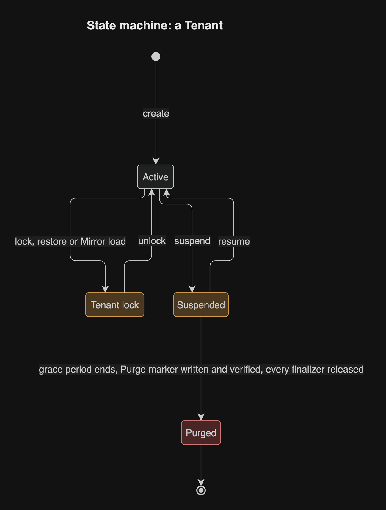

# Tenancy

The estate learns what a Tenant is: an organisation its Applications serve,
within one Environment. This page is the home of that design. It holds one
section per decision, and each section is filled when its record is written.
Until then a section only says which ticket fills it. The decisions are the
Proposed records that the [register](../decisions/register.md) plans as rows
75 to 84; where a page and a record disagree, the record wins and the page is
what gets fixed. The terms are those of the [vocabulary](../vocabulary.md):
Environment, Tenant, Tenant key, Tenant handle, Tenant export, Backup
generation, Mirror, Membership, Canary Tenant, Tenant lock, Tenant hook, Tenant
Admin, Suspended, Purge, Purge marker and Causation id.

The whole design is the spec in
[issue 137](https://github.com/JorisJonkers-dev/estate-kit/issues/137). Two
research notes back it, with sources:
[multi-tenancy](../research/multi-tenancy.md) and
[multi-cluster](../research/multi-cluster.md). Tenancy is something a Project
opts into: media apps and platform tools stay single-tenant. Everything is
designed now and ships as additive 1.x releases of the model after the
cutover, so the shadow's parity with deploy-kit 1.0 is not disturbed.

## Who must act

| Who | What changes for them |
| --- | --- |
| estate-kit | The model gains Environments, Tenants and Product domains; a sixth bounded context, tenancy, holds the lifecycle; the platform components reconcile a Tenant |
| identity (Go) | One identity per Environment, Memberships in many Tenants, Tenant Admins, and change events for Applications |
| go-commons | The tenancy library for Go: set `app.tenant_id` in every transaction and the key prefix per request or message, and refuse work without exactly one Tenant |
| rust-commons | The same library for Rust, held to the same language-neutral conformance vectors |
| Multi-tenant Applications | Keep every Tenant in shared tables with `tenant_id` and row-level security, take the Tenant from the principal, and implement the Tenant hooks they declare |

## Environments

Decided in [record 75](../decisions/0075-three-environments-run-in-the-one-cluster.md), which amends [record 9](../decisions/0009-the-live-render-is-a-signed-registry-tag-per-project-and-environment.md).

Development, staging and production run in the one cluster. Each Project in each Environment has its own signed Environment tag, `render/<project>:<env>`, and its own namespace, `<project>-<env letter>`: `-d`, `-s` and `-p`. Production moves once from `<project>-system` to `<project>-p` by a planned migration.

A merge to `main` deploys a build of `main` to development. A published release deploys to staging, then to production after the `production` approval, with the same digests in both. A Project chooses its Environments, and production is required. Between Environments only replicas, domains and secret paths may differ, plus one env file per Environment. Any other override is refused.

The staging Rollout of a release gates that release's `production` approval: one that ended Refused, Held on a failed [Analysis verdict](../../CONTEXT.md), or Observation lost blocks the approval until the maintainer confirms the staging Application served the release, while one Held on an inconclusive verdict, on a Project too quiet to gather a sample, blocks nothing ([record 132](../decisions/0132-a-staging-rollout-that-ended-refused-held-on-a-failed-verdict-or-observation-lost-blocks-its-release-s-production-approval-and-a-quiet-held-does-not.md)).

## Tenants

Decided in [record 76](../decisions/0076-tenants-are-the-organisations-the-estate-serves.md), which rewords [record 1](../decisions/0001-one-maintainer-one-cluster-one-estate.md)'s "no second tenant" as "no second operator or team".

A Tenant is an organisation the estate's Applications serve, within one Environment. The same organisation in staging and in production is two Tenants. A Tenant is served by the estate and does not run it, so the estate still has one maintainer. The design is meant to hold more than 1000 Tenants.

A Tenant has a Tenant key, `<env letter>_<name>`, that never changes and is never reused. Its name matches `^[a-z][a-z0-9]{1,15}$`. It also has a Tenant handle, which its people see in URLs. The handle is unique within its Environment and can change; a former handle redirects for a grace period of 90 days. A handle that ends in `-staging` or `-dev` is refused.

A User has one account per Environment and Memberships in many Tenants. Tenancy is something a Project opts into, and a Project that does not is unchanged. Kotlin services stay single-tenant until they are rewritten in Rust.

## Domains and hosts

Decided in [record 77](../decisions/0077-product-domains-are-admitted-by-platform-intent.md), which rests on [record 10](../decisions/0010-platform-intent-admits-the-projects-and-is-pushed-like-any-project.md).

Platform Intent lists the estate's domains and the Projects admitted to use each. An Application in a multi-tenant Project names its Product domain, and its Tenant hosts are derived: `<handle>.<Product domain>` in production, `<handle>.staging.<Product domain>` in staging and `<handle>.dev.<Product domain>` in development. The environment suffix is the Tenant host's own DNS label, so each Environment has its own wildcard certificate, one per Product domain and Environment suffix, issued by fleet-infra, whose expiry estate-kit's alert names ([record 125](../decisions/0125-fleet-infra-issues-the-wildcard-certificate-per-product-domain-and-environment-suffix.md)). A per-environment override may name another Product domain that Platform Intent admits for the Project.

A Product domain that Platform Intent does not admit is refused. Two Projects that claim one Product domain are refused with a contention diagnostic that points at both. A host resolves to a Tenant through a lookup, never by parsing the host, so custom domains can later be added as more rows.

Platform Intent also holds the estate's stable name, a DNS-style name of at most 32 characters. It is the seam a later second cluster or estate can use as its cluster ID.

## Tenant data

Decided in [record 114](../decisions/0114-multi-tenant-projects-keep-their-tenants-in-shared-tables-separated-by-row-level-security.md), which supersedes [record 78](../decisions/0078-a-multi-tenant-project-keeps-one-tenant-database-per-tenant.md)'s database per Tenant.

A multi-tenant Project keeps every Tenant's data in shared tables, in one database per Environment, as a single-tenant Project does. Each tenant-scoped table has a `tenant_id` column holding the Tenant key, a row-level security policy on it, and `FORCE ROW LEVEL SECURITY`; only a table the Project declares shared reference data has none. No Tenant moves between Postgres servers. Sharding by `tenant_id` waits for a later record, written only if one database cannot carry the load.

The tenancy library runs `SET LOCAL app.tenant_id = '<tenant key>'` in every transaction, from the signed Principal, so a transaction with no Tenant set matches no rows. A per-Project owner role with `BYPASSRLS` owns the tables, and only `migration-run` Jobs and the backup component use it. Application roles have no `BYPASSRLS` and own no table.

Three leak checks hold this: a schema lint (every table has `tenant_id`, a policy and `FORCE`, unless declared shared reference data), a two-Tenant test per Project (write as one Tenant, read as another or with no Tenant set, and expect nothing) and a role audit (no Application role bypasses the policy or owns a table).

Each Environment has its own Postgres server and its own Valkey, with keys prefixed `<app>:<tenant key>:` and one ACL user per Application limited to `<app>:*`. Each has one RabbitMQ vhost with shared queues. Each Project has one Garage bucket per Environment, with each Tenant's objects under its key.

The [research](../research/multi-tenancy.md#1-data-isolation-on-postgres) recommends shared tables. The maintainer first chose a database per Tenant, then reversed it on 2026-11-04 for one model to build, migrations without waves, and a cost that does not grow with the Tenant count. A [scale test at 1000 Tenants](../decisions/0109-a-row-level-security-scale-test-at-1000-tenants-runs-before-the-tenancy-machinery.md) measures the policy cost, index use, a noisy Tenant, and a Tenant's export, restore and Purge before the tenancy machinery is built.

## The Tenant of a request

Decided in [record 79](../decisions/0079-the-tenant-of-a-request-comes-only-from-the-signed-principal.md).

A request's Tenant comes from one place: the Gate's signed Principal. The Gate
looks the host up to find the Tenant, checks that the User has a Membership in
it, and signs the Tenant key and that Tenant's App Roles into the Principal and
the token. An Application trusts nothing else. A service that calls another
passes that token, or an RFC 8693 exchange of it that keeps the Tenant.

Every request and every message names exactly one Tenant. The shared libraries
refuse work with none and work with two. A producer sets a Tenant header on
each message, which belongs to no one broker, and a consumer sends a message
without one to its dead-letter queue.

A Causation id travels unchanged through every request, job and message a
chain causes. Each step keeps its own trace, linked to its cause. The Tenant
key and the Causation id go on logs and spans, never on general metric labels.

The tenancy contract and its language-neutral conformance vectors are planned.
The Rust library, the Go library and identity run them, and the contract is
Locked by default once written.

## The Tenant resource

Decided in [record 80](../decisions/0080-a-tenant-is-a-custom-resource-in-a-sixth-bounded-context-tenancy.md), which amends [record 50](../decisions/0050-six-bounded-contexts-in-five-layers.md): the workspace has six bounded contexts, and tenancy is the sixth.

A Tenant is a custom resource, one per Tenant in its Environment. Only Delivery writes it. The platform components that hold the Tenant's data (identity, mailbox, backup and secret-grant) reconcile it, and each holds a finalizer, so a Purge completes only when every one has cleaned up. A Tenant has no database of its own, so database-catalog does not reconcile it; the backup component deletes the Tenant's rows under each Project's owner role.

The tenancy context holds the Tenant model and the Tenant operations, listed in [record 80](../decisions/0080-a-tenant-is-a-custom-resource-in-a-sixth-bounded-context-tenancy.md). Every operation is safe to retry. Each step, with its full error output, goes to an append-only operation log on the shared platform-postgres. The lifecycle API is part of Delivery's OpenAPI contract, and the maintainer and a product's sign-up flow both call it.

A multi-tenant Application takes part through the Tenant hooks it declares, which [record 80](../decisions/0080-a-tenant-is-a-custom-resource-in-a-sixth-bounded-context-tenancy.md) lists. A hook is an HTTP call with a signed machine token, the Tenant key and an operation id. A failed lock or prepare-restore hook aborts before any data changes; a failed after hook flags the Tenant. During a Tenant lock the Gate serves a standard maintenance page and a 503 with Retry-After, and the libraries hold the Tenant's work. Ending a Tenant is Suspend, a grace period of 30 days, then Purge.

The estate is a processor of a Tenant's people's data, so a Tenant asks for its data as the operation `export`: the tenancy context makes one export per Project database that holds the Tenant's rows and calls each Application's export hook, which hands over the data it keeps where the platform cannot see it; Tenant exports are signed after the first Mirror has run ([record 129](../decisions/0129-the-estate-is-a-processor-record-80-gains-a-tenant-export-hook-and-the-erasure-date-is-stated-to-the-tenant.md)).

## Migrations

Decided in [record 81](../decisions/0081-migrations-reach-tenant-databases-in-waves.md), as [record 114](../decisions/0114-multi-tenant-projects-keep-their-tenants-in-shared-tables-separated-by-row-level-security.md) amends it.

A multi-tenant Project must declare a Liquibase changelog. The compiler refuses `migration: self` and `migration: none` there.

Every revision is expand/contract. The `migration-run` component runs it once per Project database per Environment, in one transaction wherever Postgres allows it, so a failure leaves the old schema. A new Tenant needs no migration.

`migration-run` keeps its migration record in a custom resource it owns. A failed revision marks the Project database failed there, and the current version keeps serving. The Release Gate then refuses further releases of the Project in that Environment until an Operator retries the migration or explicitly requests a [Roll-forward](../decisions/0101-a-rollout-rolls-forward-when-rolling-back-would-run-a-migration-backwards.md); nothing automatic may do either. The refusal is a read of cluster state, so it adds no write to [record 74](../decisions/0074-the-release-gate-and-observation-each-have-a-named-write.md).

Canary Tenants are only a targeting group for feature flags inside Applications: a flag is on for them first, then for everyone. Deploy canaries stay weight-based through Flagger.

## Backups and Mirrors

Decided in [record 82](../decisions/0082-backups-are-per-tenant-generations-and-mirrors-refresh-staging-and-development.md), as [record 114](../decisions/0114-multi-tenant-projects-keep-their-tenants-in-shared-tables-separated-by-row-level-security.md) amends it, the Purge in [record 110](../decisions/0110-a-purge-erases-backup-generations-and-mirrors-from-an-inventory-of-every-copy.md), where the copies live in [record 115](../decisions/0115-backups-are-kopia-snapshots-in-one-locked-repository-per-environment-on-an-eu-object-store-with-wal-archived-beside-them.md), the restore's steps in [record 127](../decisions/0127-a-restore-names-the-projects-it-restores-takes-a-verified-safety-copy-first-and-never-crosses-into-a-lower-environment-unmasked.md) and the Purge marker in [record 128](../decisions/0128-a-purge-writes-and-verifies-its-purge-marker-in-the-locked-repository-before-it-deletes-anything-and-a-restore-does-not-un-purge-the-tenant.md).

A Backup generation is the set of one Tenant's Tenant exports, taken on that Tenant's own schedule: one export per Project database, `COPY ... WHERE tenant_id` in one snapshot transaction, with that database's migration revision. The exports share no point in time, because Projects own their data and talk through APIs. Each export is its own source in the Environment's Kopia repository, which encrypts it and keeps it in a bucket on Scaleway Object Storage under a 30-day COMPLIANCE object lock; that bucket is the off-cluster copy. Each Environment has its own repository and password. The generation is listed in one central catalogue. This replaces the backup component's scope per Project for a multi-tenant Project. Each Postgres server also keeps whole-database backups in the same repository (7 daily, 4 weekly, 6 monthly) and archives WAL continuously to the same provider for point-in-time recovery, for disaster only. The latest snapshot of each store is restored into throwaway containers and checked every week.

A restore names the Projects it restores. It writes and verifies a safety copy
of the Tenant's current rows first — one export per Project named, written to
the Environment's backup repository — and a restore whose safety copy fails
changes nothing
([record 127](../decisions/0127-a-restore-names-the-projects-it-restores-takes-a-verified-safety-copy-first-and-never-crosses-into-a-lower-environment-unmasked.md)).
It refuses an export newer than its database and names both revisions, then
locks the Tenant, runs the prepare-restore hook, deletes the Tenant's rows and
re-inserts them, runs the after-restore hook and unlocks. An export at the
database's revision goes in directly; an older one is loaded into a scratch
database built from a schema dump of the Project database at its own revision,
migrated forward there, then copied in. A failure after the first delete leaves
the Tenant locked, and the retry retraces its steps from the safety copy.

A staging or development Tenant may Mirror one production Tenant on a schedule. Production's backup component reads the production exports, masks them when the Mirror requires it, and writes them into the target Environment's Kopia repository, whose password production holds; a lower Environment never holds production's credentials. The target Environment locks its Tenant, deletes its rows, imports the exports under its `tenant_id`, runs the after-restore hooks and unlocks. A failure leaves the Tenant locked. Development is always masked; staging is masked only when it says so. Each Project declares masking rules for its own tables, and a Project with none is not loaded into a development Mirror. Staging and production Tenants exist independently.

A Purge writes and verifies the Tenant's Purge marker in the locked
repository before it deletes anything, and a Purge whose marker write fails
deletes nothing
([record 128](../decisions/0128-a-purge-writes-and-verifies-its-purge-marker-in-the-locked-repository-before-it-deletes-anything-and-a-restore-does-not-un-purge-the-tenant.md)).
The marker, named by an opaque UUID like the tombstones and the Purge inventory
entries, holds the Tenant catalogue's entry for the Tenant and its key, and
platform-postgres only caches what it holds. A restore does not un-purge a
Tenant: a store restored to a time before a Purge is re-read its markers, and
each Purged Tenant removed again, before it serves. A Purge then deletes the
Tenant's rows and its export snapshots, runs full maintenance on the backup
repository, and empties every Mirror target of the Tenant at once. Its entry
in the operation log states the erasure date: the expiry of the last copy in
the copy inventory, which is the end of six months of whole-database retention,
and the Tenant is told the date
([record 129](../decisions/0129-the-estate-is-a-processor-record-80-gains-a-tenant-export-hook-and-the-erasure-date-is-stated-to-the-tenant.md)).
Whole-database backups are kept up to 6 months and WAL no longer than the
oldest base backup kept; the 30-day object lock bounds only the Tenant exports.

A Backup generation may be restored into its own Tenant or into another Tenant
of its own Environment. A restore never crosses into a lower Environment
unmasked: a lower target masks before the export leaves, by the Mirror's rules
and not the caller's choice, and a restore that would land unmasked in a lower
Environment is refused.

An unmasked staging Mirror puts production personal data in staging, so staging access must be treated like production access: who may sign in, where logs go, and how long data is kept.

## What identity must do

Identity has its own repository, which records these in its own decisions. They are obligations on identity, not estate-kit records.

- Identity runs once per Environment, each with its own Issuer.
- It holds Tenants, Memberships, Tenant-scoped Assignments and the Tenant Admin.
- The Gate resolves a host to a Tenant by lookup, checks the Membership, and signs the Tenant key and that Tenant's App Roles into the Principal and the tokens.
- An Application refreshes its extended profile from the token at every sign-in. Identity publishes UserChanged, UserRemoved and Membership-removed events on RabbitMQ, keyed by subject and carrying only the synced fields (email and name).
- Break-glass Memberships for the maintainer are time-limited and audited.
- Client redirect validation accepts the Tenant hosts under the Client's Product domain.

## Secrets

Decided in [record 83](../decisions/0083-secrets-are-scoped-by-environment-and-tenant-secrets-live-beneath-their-project.md).

Every Vault path an Application reads is `secret/<env>/<project>/…`. The platform derives the environment and the Project, so a secret grant still writes its path relative to its Project and never names the Environment. Each Environment's Applications have a Vault role that reaches only their own Environment's paths, so a staging Application cannot read a production secret.

A multi-tenant Application writes Tenant-specific secrets at runtime under `…/tenants/<tenant key>/`, beneath its Project's path. The path uses the Tenant key, never the handle. A Purge removes everything beneath it.

## Mail

Decided in [record 84](../decisions/0084-a-tenant-sends-mail-as-its-product-domain-until-it-verifies-its-own.md). Amends [record 33](../decisions/0033-a-mailbox-is-declared-by-its-local-part-and-owned-by-one-project.md).

A Tenant without a Verified domain sends from `noreply@<Product domain>`, with its display name as the sender name. A Tenant Admin can verify a domain of the Tenant's own: the platform names the DKIM, SPF and DMARC records to publish, checks them, and records the domain as verified only when all three are right. The mailbox component then reconciles it from the Tenant resource as its own Stalwart domain with its own DKIM key, and removes it at Purge.

Stalwart's community edition is enough. Its Enterprise tenant feature, and hosted mailboxes for a Tenant's people, are out of scope.
