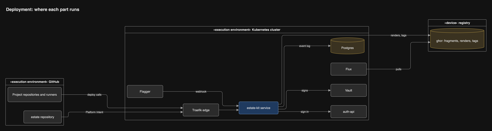
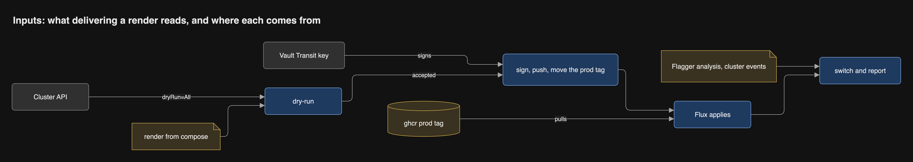

# Where state lives

No repository holds a list of what is deployed, and no lock file sits outside a
Project. What runs is recorded by the cluster itself, and each Project's
history by its own repository.

## Every fact, today and in estate-kit

| Fact | Today | estate-kit |
| --- | --- | --- |
| Image digests | `images.lock.yml` in estate, plus each build's share | Sealed into the signed Intent Fragment at release, each registered by the Project's own build; no file in git |
| Current render of a Project | Pin commit in `estate/projects/
/source.yaml` | Signed registry tag `render/
:prod` that the service moves |
| What runs | Flux status, read back via the estate repo | Flux and Kubernetes object status, read live |
| Release history | Pin commits plus GitHub Deployments | GitHub Deployments on each Project's repository, and the service's event log on the shared platform-postgres |
| Paused, rolled back to X | Pin commits by `pause.yml` and `rollback.yml` | One cluster object per Project, written only by the service; a missing object reads as Paused |
| ClusterState | `cluster-state.yml`, committed by the Collector | Read live; each snapshot digested into the render key, kept as provenance |
| Which Projects may deploy | `participants.yml` | Admitted Projects, declared in Platform Intent |
| Estate-wide policy | `platform.intent.yml` and the node contract in estate | Same, in the thin estate repo |
| Toolchain config | Copied per repository | Central in estate-kit, inherited through presets and reusable workflows |
| Rendered files | Signed OCI artifacts in ghcr | Same, kept with their signatures; no render cache, and an unchanged render is not published again |
| Per-Project Flux sources | Rendered from the pin files | Derived from the admitted Projects into one platform render |

## Where each part runs

Only signed, digest-named artifacts cross from GitHub and ghcr into the
cluster.

## Inside the cluster

The service talks to Vault, the API server, auth-api and the shared
platform-postgres. Flux alone applies, locked down so each Project's
Kustomization runs as that Project's service account in its own namespace.

## Where each compile input comes from

Validation needs only the Project repo. Composition needs four inputs, each
pinned by digest: the fragment, Platform Intent, the ClusterState snapshot and
the compiler version.

## What each delivery stage consumes

Each stage takes the previous stage's output plus one outside input: the API
server, the Vault key, the `prod` tag, or Flagger's analysis.

## How Platform Intent arrives

The estate repo is the platform Project. Its release workflow validates,
publishes and calls the service over OIDC like any Project; the service keeps
the new copy as a cache.

## The nightly drift check

The service compares three views of every admitted Project: the latest release
on GitHub, the latest fragment and prod tag in ghcr, and its own cached copy. A
difference is reported, never repaired silently.

