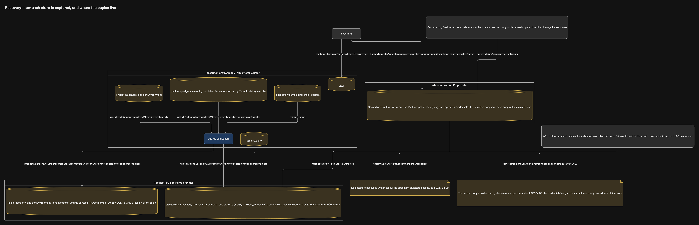
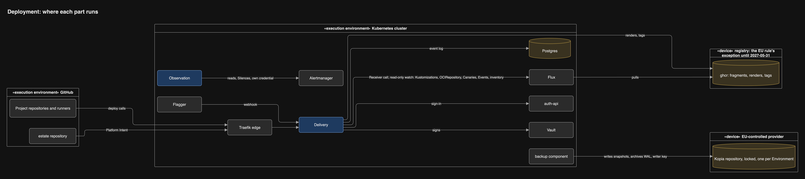
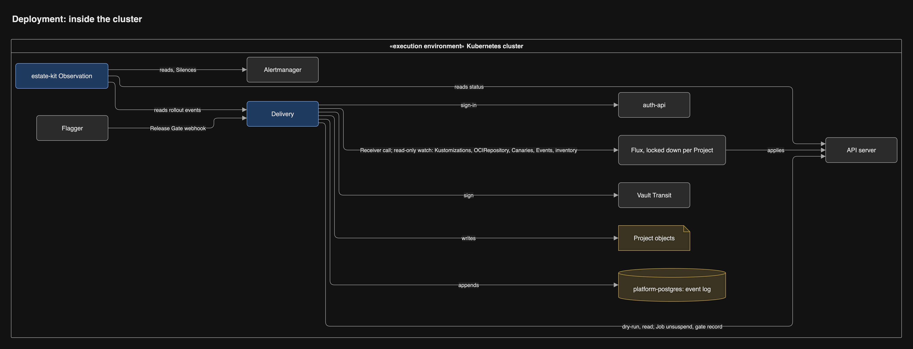
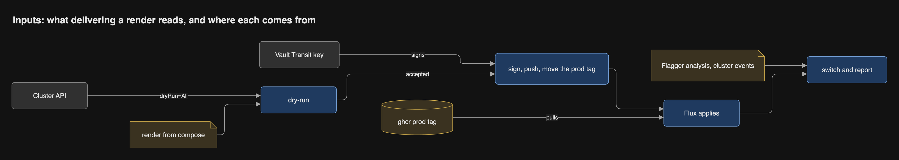
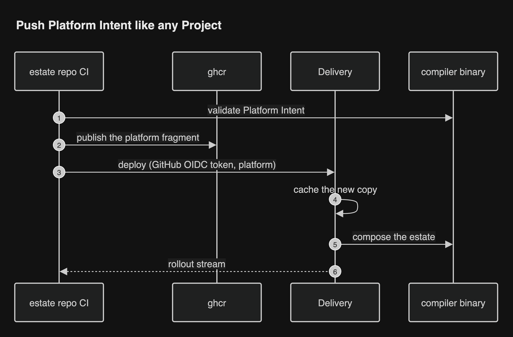
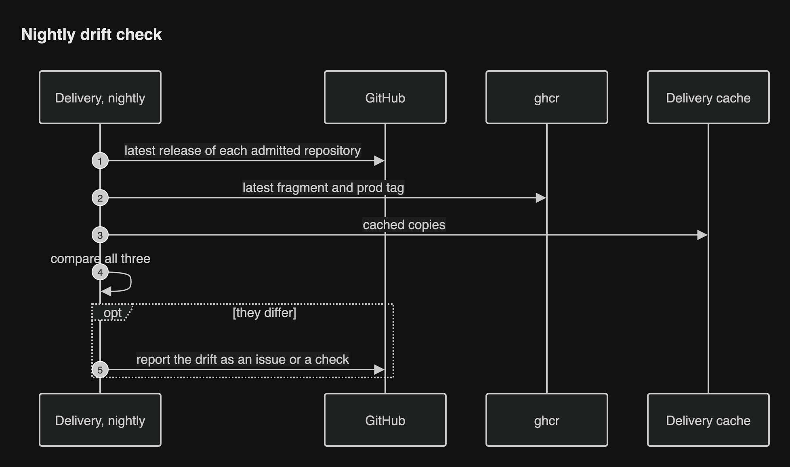

# Where state lives

No repository holds a list of what is deployed, and no lock file sits outside a
Project. What runs is recorded by the cluster itself, and each Project's
history by its own repository.

## Shared Project databases and Tenant exports

A multi-tenant Project keeps every Tenant's data in shared tables, in one
database per Environment, as a single-tenant Project does ([record 114](../decisions/0114-multi-tenant-projects-keep-their-tenants-in-shared-tables-separated-by-row-level-security.md)). Each tenant-scoped table has a `tenant_id` column holding the Tenant key, a row-level security policy on it, and `FORCE ROW LEVEL SECURITY`; only a table the Project declares shared reference data has none. No Tenant moves between Postgres servers. Sharding by `tenant_id` waits for a later record, written only if one database cannot carry the load.

A Backup generation is the set of one Tenant's Tenant exports, taken on that
Tenant's own schedule: one export per Project database, `COPY ... WHERE tenant_id` in one snapshot transaction, with that database's migration revision. The exports share no point in time, because Projects own their data and talk through APIs. Each export is its own source in the Environment's Kopia repository, which encrypts it and keeps it in a bucket on Scaleway Object Storage under a 30-day COMPLIANCE object lock; that bucket is the off-cluster copy. Each Environment has its own repository and password. The generation is listed in one central catalogue.

A restore names the Projects it restores. It refuses an export newer than its database and names both revisions, then locks the Tenant, runs the prepare-restore hook, deletes the Tenant's rows and re-inserts them, runs the after-restore hook and unlocks. An export at the database's revision goes in directly; an older one is loaded into a scratch database at its own revision, migrated forward there, then copied in. A failure after the first delete leaves the Tenant locked.

## Kopia repositories per Environment and the WAL archive

Backups are Kopia snapshots in one locked repository per Environment on an EU
object store, with WAL archived beside them ([record 115](../decisions/0115-backups-are-kopia-snapshots-in-one-locked-repository-per-environment-on-an-eu-object-store-with-wal-archived-beside-them.md)).

**One Kopia repository per Environment.** Production, staging and development
each have one Kopia repository, in a bucket of its own on Scaleway Object
Storage in nl-ams, with its own random password. The password is kept in Vault
under the Environment's path and in the maintainer's offline store, from which
[record 106](../decisions/0106-the-control-plane-is-restored-in-a-dependency-order-that-is-tested-drilled-and-timed.md)
restores. Production also holds the lower Environments' passwords, to push
Mirror exports; a lower Environment never holds production's password or
writer key.

**The lock is the off-cluster copy.** Every object Kopia writes carries an
object lock in COMPLIANCE mode for 30 days. Full maintenance runs more often
than the lock period and extends the locks of every blob still in use. Each
Environment's writer key can write objects and cannot delete an object version
or shorten a lock. A noncurrent version is removed once its lock has ended, by
a lifecycle rule on the bucket or by a clean-up job whose key the backup
component does not hold. That one locked bucket per Environment is the
off-cluster copy; there is no second provider and no local copy.

**What goes in.** Each Tenant export and the contents of local-path volumes are
each a Kopia source, taken by a scheduled job per source, with no two runs of
one source at once, and each export kept for the retention set with its
Tenant's schedule and stated in the copy inventory of
[record 110](../decisions/0110-a-purge-erases-backup-generations-and-mirrors-from-an-inventory-of-every-copy.md).
Every Postgres server's capture, whole-database backups and platform-postgres
included, moved to [record 120](../decisions/0120-postgres-is-captured-by-pgbackrest-base-backups-plus-archived-wal-in-a-locked-bucket-on-every-server.md)'s
pgBackRest base backups, which keep 7 daily, 4 weekly and 6 monthly. The
datastore's backup and Vault's snapshots stay
fleet-infra's, as [record 59](../decisions/0059-vault-unseal-and-datastore-backup-are-assumed-from-fleet-infra.md) says; the rule of [record 116](../decisions/0116-every-store-of-estate-data-runs-on-an-eu-controlled-provider-or-on-owned-hardware.md) binds where they go.

**WAL beside them, in a locked bucket.** Every Postgres server archives its
WAL continuously, through pgBackRest, to a bucket of its own Environment at
the same provider, and switches segment at least every 5 minutes, so the
15-minute recovery point of [record 87](../decisions/0087-recovery-time-and-recovery-point-are-stated-per-recovery-class.md) holds on a quiet database. Every object in the WAL bucket carries an object lock in COMPLIANCE mode for 30 days; the Environment's WAL writer key writes and cannot delete an object version or shorten a lock, a maintenance job extends the locks of the WAL objects still kept, and a lifecycle rule removes a WAL object once its lock has ended and it precedes the oldest base backup kept. WAL is kept no longer than the oldest base backup kept ([record 120](../decisions/0120-postgres-is-captured-by-pgbackrest-base-backups-plus-archived-wal-in-a-locked-bucket-on-every-server.md)).

**A restore is rehearsed every week.** The backup component restores the latest
capture of each store into throwaway containers once a week and checks what it
reads back. Each result is an active check result of [record 108](../decisions/0108-active-checks-run-in-the-owning-components-observation-reads-their-results-and-one-heartbeat-lives-outside-the-cluster.md): Observation reads it, and a pass also reaches the external heartbeat, so a rehearsal that stops running raises an alert from outside the cluster. The restore order is rehearsed in CI on every release, and a timed drill runs on the real estate once a year, as [record 106](../decisions/0106-the-control-plane-is-restored-in-a-dependency-order-that-is-tested-drilled-and-timed.md) sets out.

## Each store's Recovery class

Recovery time and recovery point are stated per Recovery class before the drill,
and the drill measures them ([record 87](../decisions/0087-recovery-time-and-recovery-point-are-stated-per-recovery-class.md)). Each Recovery class has a recovery time objective (how long from loss until it serves again) and a recovery point objective (how much recent data may be lost), set by the maintainer before the first drill. The restore proof and the yearly drill measure each class against its targets and record the result; a miss is an issue, never a quiet change of the target. A new store is put in a class before it holds production data.

The maintainer set the targets below on 2026-11-04. The column "How it is met" names the mechanism the drill measures; where it is estate-kit's, it is [record 115](../decisions/0115-backups-are-kopia-snapshots-in-one-locked-repository-per-environment-on-an-eu-object-store-with-wal-archived-beside-them.md)'s or [record 120](../decisions/0120-postgres-is-captured-by-pgbackrest-base-backups-plus-archived-wal-in-a-locked-bucket-on-every-server.md)'s.

| Recovery class | What it holds | How it is met | RTO | RPO |
| --- | --- | --- | --- | --- |
| Datastore | The k3s datastore: every Kubernetes object, ProjectControl and Tenant resources included | fleet-infra's backup and restore ([record 59](../decisions/0059-vault-unseal-and-datastore-backup-are-assumed-from-fleet-infra.md)), taken at least every 6 hours; none is written today, carried as the open item [datastore backup](https://github.com/JorisJonkers-dev/estate-kit/issues/41), due 2027-04-30 | 4 h | 6 h |
| Vault | Secrets, Transit keys, policies | A raft snapshot every 6 hours with an off-cluster copy | 4 h | 6 h |
| Delivery's history | The Rollout event log, the job table and the Tenant operation log on the shared platform-postgres | pgBackRest base backups of platform-postgres with its archived WAL ([record 120](../decisions/0120-postgres-is-captured-by-pgbackrest-base-backups-plus-archived-wal-in-a-locked-bucket-on-every-server.md)) | 24 h | 24 h |
| Tenant and Project databases | Every Project database, a multi-tenant Project's shared database included ([record 114](../decisions/0114-multi-tenant-projects-keep-their-tenants-in-shared-tables-separated-by-row-level-security.md)) | pgBackRest base backups and the WAL archived continuously, for a server; Tenant exports, for one Tenant ([record 82](../decisions/0082-backups-are-per-tenant-generations-and-mirrors-refresh-staging-and-development.md), [record 120](../decisions/0120-postgres-is-captured-by-pgbackrest-base-backups-plus-archived-wal-in-a-locked-bucket-on-every-server.md)) | 4 h | 15 min |
| Volume contents | Local-path volumes other than Postgres | A daily snapshot in the Environment's Kopia repository; a datastore backup does not restore them | 24 h | 24 h |
| Registry | Renders, their signatures and the tags that name them | Held by the registry provider, off the cluster, with a nightly copy; a render can be composed again from its pinned inputs, a tag cannot | 24 h | 24 h |
| Binary cache | Host closures | Off the cluster; rebuilt in CI from the pinned source | 24 h | none: rebuildable |
| Second copy of the Critical set | A copy of each item of the [Critical set](../../CONTEXT.md): the Vault snapshot, the signing and repository credentials, and the datastore snapshot ([record 141](../decisions/0141-a-second-copy-exists-only-for-the-critical-set-at-a-second-eu-provider.md)) | At a second EU provider, written with each first copy and held to a stated age: within 6 hours for the Vault snapshot and the datastore snapshot, within 24 hours of any change for a credential; its holder is not yet chosen, an open item, due 2027-04-30 | the copied class's | the copied class's |

The k3s datastore stays SQLite, deliberately different from the applications' Postgres; its restore order is [record 106](../decisions/0106-the-control-plane-is-restored-in-a-dependency-order-that-is-tested-drilled-and-timed.md)'s.

Mail, buckets and other component stores join a row, or get their own, when the restore order that orders all of them is written. The offline recovery key is not a store and has no row: its custody, which a named recovery-key successor holds a sealed copy of, is [record 140](../decisions/0140-break-glass-custody-is-written-and-drilled-and-a-named-successor-holds-a-sealed-copy-of-the-recovery-key.md)'s, an open item, due 2027-04-30, until the successor is named.

## How each store is captured

One backup component captures every store the drill covers: pgBackRest base
backups plus the archived WAL for every Postgres server
([record 120](../decisions/0120-postgres-is-captured-by-pgbackrest-base-backups-plus-archived-wal-in-a-locked-bucket-on-every-server.md)),
and Kopia snapshots for the Tenant exports and the volume contents
([record 115](../decisions/0115-backups-are-kopia-snapshots-in-one-locked-repository-per-environment-on-an-eu-object-store-with-wal-archived-beside-them.md)).
Vault's snapshots and the datastore's backup stay fleet-infra's; no datastore
backup is written today. Only the Critical set is copied twice: its
[Second copy](../../CONTEXT.md) sits at a second EU provider, and the
Second-copy freshness check of [record 141](../decisions/0141-a-second-copy-exists-only-for-the-critical-set-at-a-second-eu-provider.md)
fails when an item's newest copy grows older than the age its row states.

## Every fact, today and in estate-kit

| Fact | Today | estate-kit |
| --- | --- | --- |
| Image digests | `images.lock.yml` in estate, plus each build's share | Sealed into the signed Intent Fragment at release, each registered by the Project's own build; no file in git |
| Current render of a Project | Pin commit in `estate/projects/
/source.yaml` | Signed registry tag `render/
:<env>` — the Environment tag of each Environment; the Prod tag among them — that Delivery moves |
| What runs | Flux status, read back via the estate repo | Flux and Kubernetes object status, read live |
| Release history | Pin commits plus GitHub Deployments | GitHub Deployments on each Project's repository, and Delivery's event log on the shared platform-postgres |
| Paused, rolled back to X | Pin commits by `pause.yml` and `rollback.yml` | One cluster object per Project, written only by Delivery; a missing object reads as Paused |
| ClusterState | `cluster-state.yml`, committed by the Collector | Read live; each snapshot digested into the render key, kept as provenance |
| Which Projects may deploy | `participants.yml` | Admitted Projects, declared in Platform Intent |
| Estate-wide policy | `platform.intent.yml` and the node contract in estate | Same, in the thin estate repo |
| Toolchain config | Copied per repository | Central in estate-kit, inherited through presets and reusable workflows |
| Rendered files | Signed OCI artifacts in ghcr | Same, kept with their signatures; no render cache, and an unchanged render is not published again |
| Per-Project Flux sources | Rendered from the pin files | Derived from the admitted Projects into one platform render |

## Where each part runs

Only signed, digest-named artifacts cross from GitHub and ghcr into the
cluster.

## Inside the cluster

Delivery talks to Vault, the API server, auth-api and the shared
platform-postgres. Flux alone applies, locked down so each Project's
Kustomization runs as that Project's service account in its own namespace.

## Where each compile input comes from

Validation needs only the Project repo. Composition needs four inputs, each
pinned by digest: the fragment, Platform Intent, the ClusterState snapshot and
the compiler version.

## What each delivery stage consumes

Each stage takes the previous stage's output plus one outside input: the API
server, the Vault key, the `prod` tag, or Flagger's analysis.

## How Platform Intent arrives

The estate repo is the platform Project. Its release workflow validates,
publishes and calls Delivery over OIDC like any Project; Delivery keeps
the new copy as a cache.

## The nightly drift check

Delivery compares three views of every admitted Project: the latest release
on GitHub, the latest fragment and prod tag in ghcr, and its own cached copy. A
difference is reported, never repaired silently.

